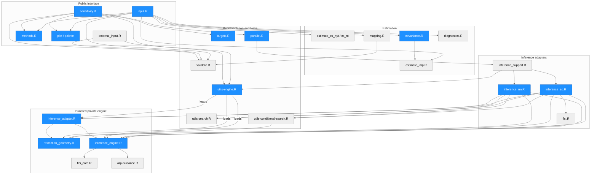
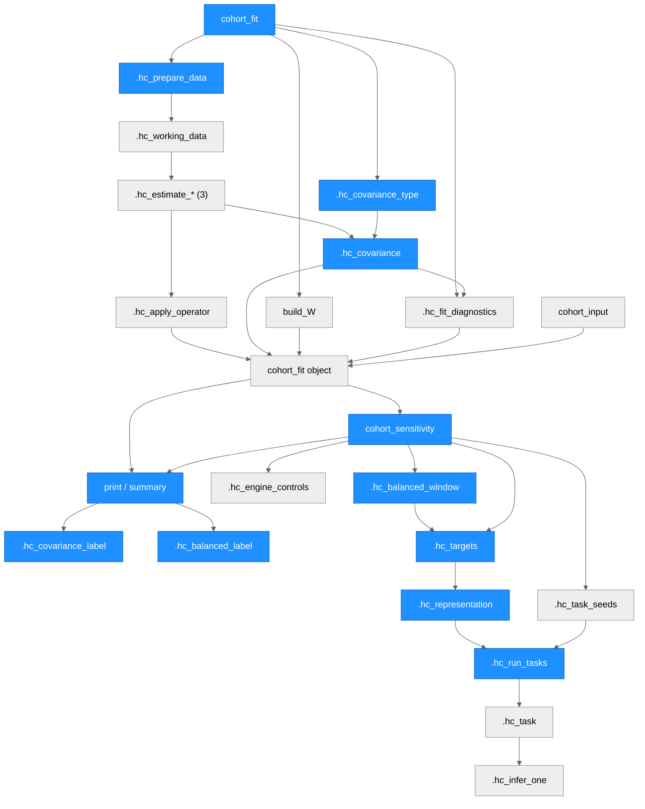
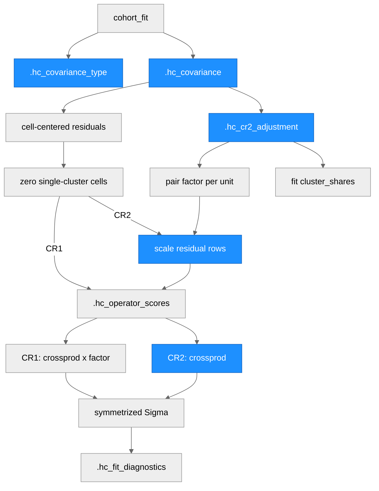
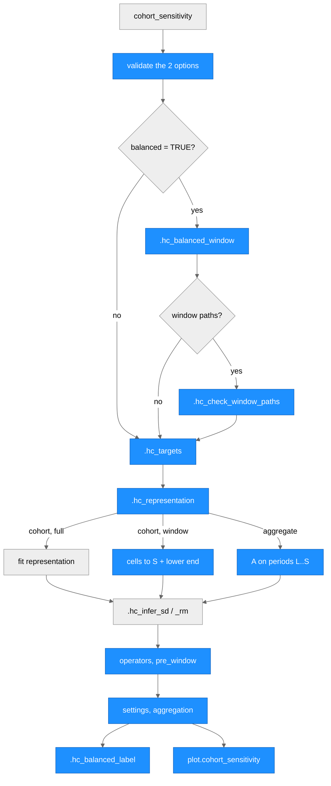
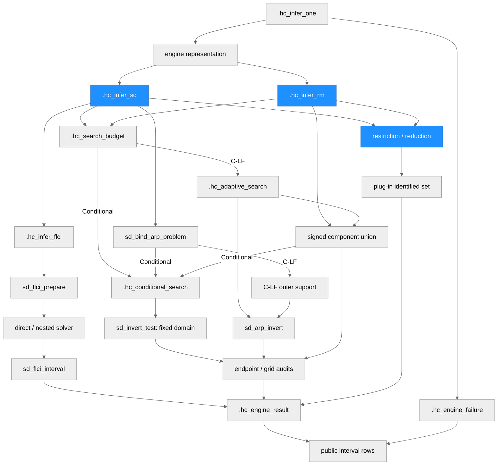
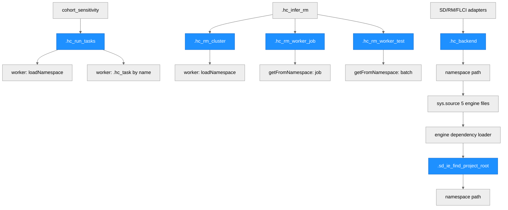
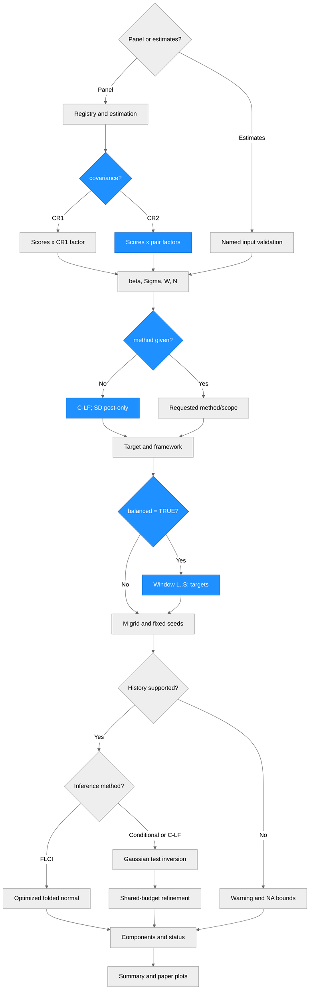

# Architecture — CohortHonestDiD

> Architecture of CohortHonestDiD 0.2.0. The package was formerly distributed as HonestDiDbyCohort (versions 0.1.0
> and 0.1.1). Version 0.2.0 renames it, prepares the repository for GitHub, makes the default inference procedure
> follow the paper's recommendation (C-LF under SD and RM, with the post-only restriction under SD), adds the
> bias-reduced CR2 covariance as an option of `cohort_fit()`, and adds balanced targets and balanced aggregation to
> `cohort_sensitivity()` (`balanced = TRUE`, with the cohort-side option `cohort.paths`); see [NEWS](NEWS.md). Calls
> that state `method` explicitly, use the default CR1 covariance and keep the default `balanced = FALSE` return the
> same numerical results as version 0.1.1. Blue nodes in the diagrams mark the code changed in 0.2.0.

## Overview

CohortHonestDiD implements cohort-anchored HonestDiD sensitivity analysis for difference-in-differences designs with
staggered adoption, as proposed in Liu (2026), "Cohort-Anchored HonestDiD" (working paper). It estimates full
cohort-period coefficients and their joint cluster covariance, then applies the smoothness (SD) and
relative-magnitude (RM) restrictions of Rambachan and Roth (2023) to each cohort's block bias through an
estimator-specific bias map `W`. The package accepts either a panel (`cohort_fit()`) or named external estimates
(`cohort_input()`). Both routes produce the same `cohort_fit` representation; `cohort_sensitivity()` returns every
confidence-set component together with explicit task statuses. Following the paper, `cohort_sensitivity()` uses the
C-LF procedure by default, under the post-only restriction for SD; FLCI and Conditional remain available by name.
The covariance is the cluster-robust CR1 by default; `cohort_fit(covariance = "CR2")` gives the bias-reduced CR2
covariance of Bell and McCaffrey (2002), which the paper recommends with Conditional or C-LF inference when some
cohorts contain only a few units or clusters. With `cohort_sensitivity(balanced = TRUE)` the targets use only the
balanced window, the relative periods observed for every cohort, and aggregate inference forms the aggregated event
study only on that window, with cohort weights fixed across periods (balanced aggregation). Under cohort inference,
`cohort.paths` chooses whether the restriction uses each cohort's full path (`"full"`, the default) or only its part
inside the window (`"window"`). The package is written in R (>= 4.1.0). `Matrix` supports sparse estimation,
`ggplot2` supplies plots, `parallel` and `withr` run reproducible worker tasks, and a bundled private numerical engine
under `inst/upstream/R/` uses the linear-programming (`Rglpk`, `lpSolveAPI`), normal-probability (`mvtnorm`,
`TruncatedNormal`) and matrix packages listed in Imports. The optional nested FLCI solver uses `CVXR` (Suggests).

### Repository layout

| Path | Contents | In the built package |
| --- | --- | --- |
| `DESCRIPTION`, `NAMESPACE` | Package metadata (MIT license); 5 exported functions, 10 registered S3 methods, imports | Yes |
| `R/` (23 files) | Package code; see Module Structure | Yes |
| `inst/upstream/R/` (5 files) | Bundled numerical engine, loaded at run time into a private environment | Yes |
| `inst/upstream/NOTICE`, `LICENSE-HonestDiD`, `LICENSE-HonestDiD-MIT` | Attribution and MIT notices for the routines adapted from HonestDiD | Yes |
| `inst/CITATION` | `citation("CohortHonestDiD")`: the paper and the package | Yes |
| `man/` (7 Rd files) | Help pages `cohort_fit`, `cohort_input`, `cohort_sensitivity`, `build_W`, `plot_cohort`, `paper_palette`, `minimum_wage`; the argument reference of the package | Yes |
| `data/minimum_wage.rda` | County panel of the minimum-wage application (15,988 rows, 28 columns) | Yes |
| [`vignettes/getting-started.Rmd`](vignettes/getting-started.Rmd) | Short walkthrough of the minimum-wage application with the defaults: estimation, the default C-LF analysis under SD, dynamic and cohort-dynamic targets, the aggregate benchmark with a short paragraph on balanced aggregation (no chunk), RM (shown, not run), data requirements and diagnostics, a CR2 fit, and a short note on numerical results with pointers to the detailed guide and help pages for numerical controls and external estimates | Yes |
| [`vignettes/detailed-guide.Rmd`](vignettes/detailed-guide.Rmd) | Assumptions and terms; estimation with the three estimators; weights, clusters, panel histories and the CR2 covariance; targets and representations, with a full-path FLCI comparison and an executed balanced example on the minimum-wage fit (subsection "Balanced targets and balanced aggregation": cohort inference with full and window paths, and aggregate inference); procedures and SD scopes; RM; reading results and outcome statuses; numerical controls and FLCI solvers; external estimates and `W`; plots. The procedure, RM, result-reading, control and external-input examples use a small artificial panel | Yes |
| `tests/testthat.R`, `tests/testthat/` (15 files) | testthat (edition 3) suite: fits, external input, sensitivity, default procedures, CR2 covariance, balanced targets and balanced aggregation, RM, refinement, Conditional domains, boundaries, plots, method equivalence, session state, adversarial oracles | Yes |
| [`README.md`](README.md), [`NEWS.md`](NEWS.md), `LICENSE` | Repository front page, change log, CRAN-style license stub | Yes |
| `LICENSE.md` | Full MIT license text | No (build-ignored) |
| `Architecture.md` | This file | No (build-ignored) |
| `data-raw/prepare-minimum-wage.R` | Adds the convenience aliases to the study input to produce `data/minimum_wage.rda`; the input file is not in the repository | No (build-ignored) |
| `.Rbuildignore`, `.gitignore` | Build and Git exclusions | No |

---

## Module Structure

Arrows describe calls or data dependencies; `covariance.R` calls the operator-score helper in `estimate_imp.R`, which
serves all three estimators. Bundled engine files live under `inst/upstream/R/`; all other modules live under `R/`.
The inference adapters reach engine functions through the private environment that `utils-engine.R` builds ("loads"
edges). Blue nodes are the files whose code changed in 0.2.0:

- `input.R`, `sensitivity.R`, `covariance.R` and `methods.R` carry the new defaults, the covariance option, the
  `balanced` and `cohort.paths` options, and the printed covariance and balanced-window lines;
- `targets.R` computes the balanced window, the balanced targets, the window-path cohort representation and the
  balanced aggregate representation; `plot.R` draws balanced results on the window (`palette.R`, in the same node, is
  unchanged);
- `inference_sd.R`, `inference_rm.R`, `restriction_geometry.R` and `inference_adapter.R` pass the window's lower end
  to the restriction operators under `cohort.paths = "window"` (see "Balanced detail" below);
- `parallel.R`, `utils-engine.R`, `inference_rm.R` and `inference_engine.R` are the four files that name the package
  at run time (see "Package-name lookups" below).

Apart from the balanced options, the numerical code of the blue inference and engine files is unchanged. With the
default `balanced = FALSE` the balanced code is not entered: targets, representations and restriction operators are
built by the same operations as before the options existed.

### Module Reference

| Module / File | Layer | Purpose | Key Exports | Changed in 0.2.0 |
| --- | --- | --- | --- | --- |
| `R/input.R` | API | Validate and complete the panel registry; forward-fill D; prepare working weights and observations; validate the covariance option; documents `minimum_wage` | `cohort_fit` | Yes: `covariance` argument (after `...`), `covariance_convention` built from the type, `cluster_shares` on CR2 fits, covariance type named in the two-cluster error; help text, including the `@source` of `minimum_wage` |
| `R/external_input.R` | API | Align named coefficients, covariance, `W` and normalization constraints | `cohort_input` | Help text only (`vcov` is used as supplied) |
| `R/sensitivity.R` | API | Validate options and resolve the method and scope defaults; set up the balanced window; form target/bound tasks; assemble public status and interval rows, the settings and, for balanced aggregate results, the `aggregation` element | `cohort_sensitivity` | Yes: `method = NULL` resolves to C-LF under SD and RM (before 0.2.0 the SD default was the full-path FLCI); formals `balanced = FALSE` and `cohort.paths = NULL` appended after `control`, their validation after all existing checks, the window set-up, and the settings fields and `aggregation` element of balanced results; help text, including the `control` pointer to the detailed guide's "Numerical controls" section and the section "Balanced targets" |
| `R/estimate_imp.R` | Estimation | Sparse outcome operator and untreated unit/time fixed-effect correction; operator application and cluster scores | None | No |
| `R/estimate_cs_nyt.R`, `R/estimate_cs_nt.R` | Estimation | Weighted paired long differences with not-yet-treated or never-treated comparisons | None | No |
| `R/covariance.R` | Estimation | Covariance option validation; cohort-period centering, cluster scores, and the CR1 or CR2 covariance; exact zero scores for single-cluster cells; CR2 shares and factors of (cluster, cohort group) pairs | None | Yes: new `.hc_covariance_type` and `.hc_cr2_adjustment`; `type` argument of `.hc_covariance` |
| `R/mapping.R` | Estimation | Full bias map using scale-stable cohort-mass ratios | `build_W` | No |
| `R/diagnostics.R` | Estimation | Observation, cohort, cluster, normalization and covariance diagnostics; stores the CR1 factor (`NA` under CR2) | None | No |
| `R/validate.R` | Representation | Input assertions, estimator aliases, coordinate registry, normalization and cell checks | None | No |
| `R/targets.R` | Representation | Balanced window; ATT/dynamic/cohort-dynamic weights; the cohort (full or window paths) and aggregate representations | None | Yes: new `.hc_balanced_window` and `.hc_check_window_paths`; `window` argument of `.hc_targets`; `window` and `paths` arguments of `.hc_representation` |
| `R/parallel.R` | Tasks | Fixed task seeds, serial/socket dispatch and worker cleanup | None | Package-name string (2 sites) |
| `R/utils-engine.R` | Representation | Numerical controls, alignment to canonical coordinates, regular grid with optional certified bounds, result/failure constructors, private engine loading from the namespace path | None | Package-name string (1 site) |
| `R/utils-search.R` | Tasks | Shared point-evaluation budget and cache; eligible refinements and attempt diagnostics | None | No |
| `R/utils-conditional-search.R` | Tasks | Conditional domain construction, bilateral expansion, interior and endpoint audits, remembered acceptance checks and range diagnostics | None | No |
| `R/inference_support.R` | Inference | Common task entry; prehistory and deterministic-target checks | None | No |
| `R/inference_sd.R` | Inference | SD restriction and plug-in set; FLCI, Conditional or C-LF; C-LF support bounds prepared once for all attempts | None | Yes: passes the representation's `restriction_window` to `v3_sd_restriction` as `pre_window` (one line) |
| `R/flci.R` | Inference | FLCI rule and interval adapter | None | No |
| `R/inference_rm.R` | Inference | Signed RM components, optional component workers and component union | None | Package-name string (3 sites); `.hc_infer_rm` counts the signed components from the benchmark pairs inside the window and passes `pre_window` to the scenario table and the plug-in restriction |
| `inst/upstream/R/restriction_geometry.R` | Private engine | Coordinate parsing, first/second differences, SD and RM restriction matrices, RM signed scenarios | None | Yes: optional `pre_window = NULL` in `v3_first_difference_operator`, `v3_second_difference_operator`, `v3_sd_restriction`, `v3_rm_scenario_table`, `v3_rm_component_restriction` and `v3_rm_plugin_restriction`; it drops only pure pre-treatment rows that reach before the window |
| `inst/upstream/R/inference_adapter.R` | Private engine | Normalization reduction, plug-in sets, ARP geometry, RM union calculations, reusable support context and budgeted sentinel tests | None | Header comment; three lines in `v3_prepare_rm_union` and `v3_clf_rm_union` pass `restriction_window` to the RM scenario table and plug-in restriction (the file keeps its CRLF line endings and line count) |
| `inst/upstream/R/inference_engine.R` | Private engine | FLCI preparation, Gaussian tests, confidence-set inversion with explicit expansion spacing, endpoint and topology audits; loads the FLCI core and HonestDiD routines | None | Header comment; package-name string (1 site) |
| `inst/upstream/R/flci_core.R` | Private engine | Folded-normal objective, direct/nested optimization and PSD limits | None | Header comment only |
| `inst/upstream/R/arp-nuisance.R` | Private engine | Gaussian moment-inequality (ARP) calculations adapted from HonestDiD | None | No |
| `R/methods.R` | Output | S3 accessors; print/summary with the covariance label and, for balanced results, the balanced-window line; Conditional searched-range tables | `coef`, `vcov`, `print` and `summary` methods | Yes: new `.hc_covariance_label`; one `Covariance:` line in the four print methods; summary objects gain `covariance`; new `.hc_balanced_label` and one balanced-window line in `print.cohort_sensitivity` and `print.summary_cohort_sensitivity` |
| `R/plot.R`, `R/palette.R` | Output | Component-preserving plots and paper colors; bounded-search plot captions | `plot` methods; `paper_palette` | `plot.cohort_sensitivity` only: balanced-window caption sentence; conventional points limited to the window for dynamic and cohort-dynamic targets |
| `R/imports.R`, `NAMESPACE`, `DESCRIPTION` | Package | Import declarations, exports, S3 registrations and metadata | 5 exported functions | `DESCRIPTION` only (name, version, title, description, URLs) |
| `data/`, `man/`, `vignettes/`, `README.md`, `NEWS.md`, `inst/CITATION` | Data/docs | Application data, help pages, two vignettes, front page, change log, citation | `minimum_wage` data | Package name in vignettes; rewritten README; new NEWS entry and CITATION; `minimum_wage` help source; new defaults and the CR2 option in the `cohort_fit`, `cohort_sensitivity` and `cohort_input` help pages, README, NEWS and both vignettes; both vignettes rewritten and shortened, and the detailed guide's argument reference removed (the help pages document every argument); the `balanced` and `cohort.paths` options in the `cohort_sensitivity` help page (arguments, section "Balanced targets", example), one README paragraph, a NEWS bullet, a getting-started paragraph, and a detailed-guide subsection `{#balanced}` with an executed example and a `result$aggregation` row in its "Outcomes and statuses" table |
| `tests/testthat.R`, `tests/testthat/` | Tests | Regression and independent public-interface checks | None | Package name in `testthat.R` and `test-session-state.R`; `method = "FLCI"` added to the calls that relied on the earlier SD default; new `test-defaults.R`, `test-covariance-cr2.R` and `test-balanced.R` |

---

## Function Call Graph

### Estimation and dispatch

Arrows follow the order of calls and the objects they produce. `cohort_fit` passes the validated covariance type to
`.hc_covariance` and the covariance list it returns to `.hc_fit_diagnostics`. `.hc_balanced_window` runs only with
`balanced = TRUE`; its window is passed to `.hc_targets` and `.hc_representation` (see "Balanced detail").

| Function | Defined In | Called By | Calls | Changed in 0.2.0 | Purpose |
| --- | --- | --- | --- | --- | --- |
| `cohort_fit` | `input.R` | User | Covariance-type check, preparation, estimation, covariance, mapping and diagnostics | Yes: `covariance = "CR1"` after `...`; `covariance_convention`; `cluster_shares` on CR2 fits | Construct the fitted representation once |
| `.hc_covariance_type` | `covariance.R` | `cohort_fit` | `.hc_assert` | Yes (new) | Accept `"CR1"` or `"CR2"` in any case and return it in upper case; anything else errors with "covariance must be 'CR1' or 'CR2'." |
| `.hc_prepare_data`, `.hc_working_data` | `input.R` | `cohort_fit` | Validation and registry helpers | `.hc_prepare_data`: error message only (names CR1 or CR2) | Forward-fill D, retain usable Y, record any common weight divisor, require two clusters, compress balanced panels to cohort-period cells |
| `.hc_estimate_imp`, `.hc_estimate_cs_nyt`, `.hc_estimate_cs_nt` | Estimator files | `cohort_fit` | Sparse operator helpers | No | Construct the outcome contrast operator |
| `.hc_covariance` | `covariance.R` | `cohort_fit` | `.hc_cr2_adjustment` (CR2 only), `.hc_operator_scores` | Yes: `type` argument | Full joint covariance from centered cluster scores, CR1 or CR2 (see "Covariance detail") |
| `build_W` | `mapping.R` | User / `cohort_fit` | `create_delta_to_Delta_mapping_matrix` | No | Map primitive deviations to coefficient bias |
| `.hc_fit_diagnostics` | `diagnostics.R` | `cohort_fit` | Cohort, cell and eigenvalue summaries | No | Support and covariance diagnostics stored on the fit, computed from whichever `Sigma` was estimated |
| `cohort_input` | `external_input.R` | User | `.hc_check_mapping_support` and validation | No | Construct the same object from external estimates; the supplied `vcov` is used as given |
| `cohort_sensitivity` | `sensitivity.R` | User | Controls, balanced window, targets, representations, seeds and task runner | Yes: default dispatch; `balanced` and `cohort.paths` | Resolve `method` (NULL means C-LF) and, for SD, `full.path` (NULL means TRUE only for FLCI); with `balanced = TRUE`, validate `cohort.paths` (NULL means `"full"` under cohort inference), compute the window and record it; return estimates and all confidence-set components |
| `.hc_balanced_window` | `targets.R` | `cohort_sensitivity` (balanced only) | None | Yes (new) | The balanced window `c(lower = L, upper = S)` from `coordinate_info` (see "Balanced detail") |
| `.hc_check_window_paths` | `targets.R` | `cohort_sensitivity` (`cohort.paths = "window"` only) | None | Yes (new) | Reject a `W` or normalization that links a kept coefficient to one after the window |
| `.hc_targets`, `.hc_representation` | `targets.R` | `cohort_sensitivity` | Mass normalization and matrix transforms | Yes: `window` argument (both) and `paths` argument (`.hc_representation`); with `window = NULL` the same operations as before | Preserve the requested estimand across frameworks; with a window, restrict targets to periods 1 to `S`, form the aggregate path on `L` to `S`, or drop the post-treatment coefficients after `S` under window paths |
| `.hc_task_seeds` | `parallel.R` | `cohort_sensitivity` | None | No | Deterministic per-task seeds, independent of worker count |
| `.hc_run_tasks`, `.hc_task` | `parallel.R` | `cohort_sensitivity` | `.hc_infer_one`, `withr`, `parallel` | `.hc_run_tasks`: package-name string (2 sites) | Reproducible execution with worker cleanup |
| `print.cohort_fit`, `summary.cohort_fit`, `print.summary_cohort_fit`, `print.cohort_sensitivity`, `summary.cohort_sensitivity`, `print.summary_cohort_sensitivity` | `methods.R` | User | `.hc_covariance_label`, `.hc_balanced_label`; searched-range helpers | Yes: covariance line and summary element; balanced-window line | Printed headers name the procedure, scope and covariance, and for balanced results the window |
| `.hc_covariance_label` | `methods.R` | Print and summary methods | None | Yes (new) | `CR1 cluster-robust, G clusters`, `CR2 bias-reduced cluster-robust, G clusters`, `supplied to cohort_input()` for external input, or `not recorded` |
| `.hc_balanced_label` | `methods.R` | `print.cohort_sensitivity`, `print.summary_cohort_sensitivity` (balanced only) | None | Yes (new) | `Balanced window: relative periods L to S; target period 1` (or `target periods 1 to S`), then `; cohort paths: full`, `; cohort paths: window` or `; aggregate path on the window` |

### Covariance detail

The CR1 branch is the covariance of version 0.1.1, with the same operations in the same order. The blue steps exist
only for `covariance = "CR2"`; `.hc_cr2_adjustment` runs before the residual matrix is built, and its shares become
the fit's `cluster_shares`.

| Step | Defined In | Called By | Calls | Changed in 0.2.0 | Purpose |
| --- | --- | --- | --- | --- | --- |
| Cell-centered residuals | `covariance.R` | Step of `.hc_covariance` | `rowsum` | No | Residual = outcome minus the weighted mean of its cohort-period cell, over usable rows |
| Residual-by-cluster matrix | `covariance.R` | Step of `.hc_covariance` | `Matrix::sparseMatrix` | No | Balanced panels: one row per cohort-period cell of the compressed working data, holding each cluster's weighted residual sum divided by the cell mass; unbalanced panels: one row per usable observed row, holding its residual |
| Zero single-cluster cells | `covariance.R` | Step of `.hc_covariance` | None | No | Balanced (compressed) path only: a cell supported by a single cluster gets exactly zero entries, without a variance cutoff. The observed-row path for unbalanced panels has no such step |
| `.hc_cr2_adjustment` | `covariance.R` | `.hc_covariance` (CR2) | Base R (`match`, `tabulate`, `rowsum`) | Yes (new) | Pairs (cluster, cohort group) from `prepared$unit_registry`, the never-treated units forming group 0; pair share p = pair weight / group weight (unit counts when unweighted); factor `1/sqrt(1 - p)`, computed as `sqrt(total/rest)`; factor 0 for a pair that holds every unit of its group; returns the `cluster_shares` data frame and one factor per unit |
| Scale residual rows | `covariance.R` | Step of `.hc_covariance` (CR2) | None | Yes (new) | Multiply each row by the factor of its unit's pair. A compressed row is one cell of one group, so every entry of the matrix is scaled by exactly one pair factor |
| `.hc_operator_scores` | `estimate_imp.R` | `.hc_covariance` | Sparse products with the operator and its fixed-effect correction | No | Apply the estimator's linear operator to every cluster column; rows of the result are the cluster scores (`fit$cluster_scores`) |
| CR1 / CR2 sum | `covariance.R` | Step of `.hc_covariance` | `crossprod` | CR2 branch new | CR1: cross-product times `G/(G - 1) * (n - 1)/(n - p)` (G clusters, n usable rows, p nonempty cells); CR2: cross-product with no factor and `cr1 = NA` |
| Symmetrized `Sigma` | `covariance.R` | Step of `.hc_covariance` | None | No | `(Sigma + t(Sigma))/2` with coordinate names; returned with the scores, the factor, the counts and, under CR2, the shares |

### Balanced detail

The task runner and `.hc_infer_one` between the representation and the inference adapters are omitted. With
`balanced = FALSE`, `.hc_targets` and `.hc_representation` receive `window = NULL` and `paths = "full"` and return
what they returned before the options existed; the aggregate branch then uses every observed relative period. Under
`cohort.paths = "full"` the cohort representation is the same as with `balanced = FALSE`; only the target differs.

| Step | Defined In | Called By | Calls | Changed in 0.2.0 | Purpose |
| --- | --- | --- | --- | --- | --- |
| Option validation | `sensitivity.R` | `cohort_sensitivity`, after all existing checks and `.hc_engine_controls` | None | Yes (new) | `balanced` must be one non-missing logical; `cohort.paths` may be supplied only with `balanced = TRUE` and `framework = "cohort"`, and must then be exactly `"full"` or `"window"` (no partial matching); `NULL` means `"full"` under balanced cohort inference |
| `.hc_balanced_window` | `targets.R` | `cohort_sensitivity` | None | Yes (new) | From `coordinate_info` (so also for `cohort_input()` objects and unbalanced panels): `S` = the largest `s >= 1` such that periods `1..s` are observed for every cohort, `L` = the smallest `s <= 0` such that periods `s..0` are; returns the named integer `c(lower = L, upper = S)`. Errors if some cohort lacks relative period 1 (checked first) or relative period 0, which is possible only for `cohort_input()` objects. For a `cohort_fit` with adoption indices `t_1 < ... < t_G` on `T` periods, `L = 2 - t_1` and `S = T - t_G + 1` |
| `.hc_check_window_paths` | `targets.R` | `cohort_sensitivity` (`cohort.paths = "window"`) | None | Yes (new) | Error if a kept row of `W`, or a normalization row, loads on a post-treatment coefficient after `S` (scale-relative tolerance 1e-12). The bias maps that `cohort_fit()` builds never do, so only `cohort_input()` objects can fail |
| `.hc_targets(fit, target, window)` | `targets.R` | `cohort_sensitivity` | Its local `make()` (relative masses, then normalized) | Yes: `window` | Keeps the post cells with `s <= S` before the existing weight arithmetic: the ATT weights each cell of periods 1 to `S` by `m_g / (S * sum m)`, dynamic targets exist for `s = 1..S` with weights `m_g / sum m`, and cohort-dynamic targets for the cells with `s <= S`. Weight vectors still cover every coefficient of `fit`. ATT label `Average treatment effect, relative period 1` (`S = 1`) or `..., relative periods 1 to S` |
| `.hc_representation(fit, ell, framework, window, paths)` | `targets.R` | `cohort_sensitivity`, once per target | `qr.solve`, null-space embedding | Yes: `window`, `paths` | Cohort, `"full"`: the fit's own representation. Cohort, `"window"`: keeps every pre-treatment coefficient and the post-treatment coefficients up to `S` (`betahat`, `Sigma`, `W`, `normalization` and the target subset to them) and adds the element `restriction_window = L`. Aggregate: the existing construction on the period set `L..S` |
| `.hc_infer_sd`, `.hc_infer_rm` | `inference_sd.R`, `inference_rm.R` | `.hc_infer_one` | Restriction operators of the engine | Yes | Read `representation[["restriction_window"]]` (absent, hence `NULL`, except under window paths) and pass it as `pre_window`; `.hc_infer_rm` also counts the signed components from the pre-treatment cells at or after `L` |
| Restriction operators | `restriction_geometry.R` | SD/RM adapters; `v3_prepare_rm_union`, `v3_clf_rm_union` | None | Yes: `pre_window = NULL` | `v3_first_difference_operator` drops pre-treatment first differences whose earlier period is before `L` (RM benchmark candidates); `v3_second_difference_operator` drops pure pre-treatment second differences whose first period is before `L` (full-path SD). Rows that involve a post-treatment coefficient are never dropped. `v3_sd_restriction`, `v3_rm_scenario_table` and `v3_rm_plugin_restriction` pass the argument on; `v3_rm_component_restriction` uses it only when it builds the operator itself (the RM adapter passes it the windowed operator of the scenario table) |
| `v3_prepare_rm_union`, `v3_clf_rm_union` | `inference_adapter.R` | RM C-LF adapter | Scenario table, plug-in restriction | Yes (three lines) | Pass `representation[["restriction_window"]]`; `v3_align_representation` keeps the element |
| Settings and `aggregation` | `sensitivity.R` | `cohort_sensitivity` | None | Yes (new) | Only when `balanced = TRUE`: `settings` gains `balanced`, `cohort.paths` and `window` at the end, and aggregate results gain the element `aggregation` (see Notes). Estimates use the full-length target with the fit's `betahat` and `Sigma` in every case |
| `.hc_balanced_label` | `methods.R` | Print methods | None | Yes (new) | One line after `Covariance:` in `print()`, and the second line of `print(summary())` followed by a blank line |
| `plot.cohort_sensitivity` | `plot.R` | User | `.hc_event_data` (unchanged) | Yes | Caption sentence `Balanced window: relative periods L to S; cohort paths: P.` (cohort) or `Balanced window: relative periods L to S.` (aggregate); dynamic and cohort-dynamic plots draw the conventional points only for `s = L..S`; on the window the aggregated points of a dynamic plot are the balanced aggregated coefficients (`aggregation$betahat` for aggregate results) |

### Inference detail

The blue steps changed in 0.2.0 only to pass the window's lower end (`restriction_window`) to the restriction
operators under `cohort.paths = "window"`; for every other representation the element is absent and the operators
build the same rows as before. The new default changes which branch a call without `method` takes (C-LF instead of
the full-path FLCI under SD), not the branches themselves. Inference uses the covariance only through the fit's
`Sigma`, so CR1 and CR2 fits use the same code. A balanced aggregate representation enters this diagram like any
other aggregate representation.

| Function | Defined In | Called By | Calls | Changed in 0.2.0 | Purpose |
| --- | --- | --- | --- | --- | --- |
| `.hc_infer_one` | `inference_support.R` | Task runner | SD/RM adapters or explicit failure constructor | No | Check prehistory and supported stochastic quantities |
| `.hc_engine_representation`, `.hc_backend` | `utils-engine.R` | Inference adapters | Private alignment; engine loading from the namespace path | `.hc_backend`: package-name string (1 site) | Keep helpers private; support both installed and source-loaded resources |
| `.hc_infer_sd` | `inference_sd.R` | Common task entry | Restriction/reduction, plug-in, FLCI or shared-budget Gaussian inversion; C-LF support LP | Yes: `pre_window` passed to `v3_sd_restriction` | Apply either SD scope; prepare, calibrate and bound support once for all search attempts |
| `.hc_infer_rm` | `inference_rm.R` | Common task entry | Signed-component geometry, prepared support context and shared-budget union inversion | Yes: windowed component count; `pre_window` passed to the scenario table and plug-in restriction | Preserve disconnected RM sets, calibration and worker state across retries |
| `.hc_search_budget` | `utils-search.R` | SD/RM adapters | Cached point-test callback | No | Count distinct test evaluations across searches, probes, audits and retries |
| `.hc_adaptive_search` | `utils-search.R` | SD/RM C-LF adapters | Per-attempt inversion callback | No | Double regular grid intervals for eligible unresolved statuses within the limits |
| `.hc_conditional_domain`, `.hc_conditional_search` | `utils-conditional-search.R` | SD/RM Conditional adapters | Cached point tests, fixed-domain inversion and endpoint audits | No | Search concentric domains with fixed regular spacing and require two successive adjacent-domain agreements; finer retries reuse the same cache and visited-range history |
| `.hc_engine_grid` | `utils-engine.R` | SD/RM adapters | Regular grid/profile anchors, with optional certified bounds | No | Carry regular spacing separately; pad supplied C-LF support by the endpoint probe margin |
| `.hc_infer_flci` | `flci.R` | SD adapter | `sd_flci_prepare`, `sd_flci_interval` | No | Expose the optimized rule and interval diagnostics |
| `sd_flci_prepare` | Private `inference_engine.R` | FLCI adapter | Private direct/nested FLCI solvers | No | Handle PSD and exact zero-noise limits without jitter |
| `sd_bind_arp_problem`, `sd_arp_invert` | Private `inference_engine.R` | SD/RM adapters | Gaussian tests, calibration, explicit expansion spacing and shared point tests | No | Compute Conditional/C-LF sets without resimulating calibration on retry |
| `v3_clf_rm_union`, `v3_memoize_rm_union_test`, `v3_rm_verify_support_sentinels` | Private `inference_adapter.R` | RM adapter | Prepared component/support context, cached union tests and separately keyed sentinel tests | `v3_clf_rm_union` (and the `v3_prepare_rm_union` it calls): `restriction_window` passed to the scenario table and plug-in restriction | Reuse RM calibration and account for actual point work across refinements |
| `v3_rm_lf_component_support` | Private `inference_adapter.R` | RM adapter and SD C-LF | Primal/dual-checked support endpoint LPs | No | Bound the necessary LF first-stage support with the realized cutoff |
| `.hc_engine_result`, `.hc_engine_failure` | `utils-engine.R` | Inference adapters | Component/status assembly | No | Keep empty, unbounded, disconnected and unsupported results distinct |

### Package-name lookups

Socket workers start as empty R sessions, and the private engine is located on disk through the package namespace.
These are the only places where the code names its own package; the rename in 0.2.0 changed exactly these seven
string literals.

| Function | Defined In | Called By | Calls | Changed in 0.2.0 | Purpose |
| --- | --- | --- | --- | --- | --- |
| `.hc_run_tasks` | `R/parallel.R` | `cohort_sensitivity` | `makePSOCKcluster`; `clusterCall` with `loadNamespace("CohortHonestDiD")`; `parLapplyLB` with `asNamespace("CohortHonestDiD")` | Yes (2 literals) | Run target/bound tasks on socket workers that load the package from the parent's library paths |
| `.hc_rm_cluster` | `R/inference_rm.R` | `.hc_infer_rm` when `component.cores > 1` | `loadNamespace("CohortHonestDiD")` on each worker | Yes (1) | Start component workers for a single RM task |
| `.hc_rm_worker_job` | `R/inference_rm.R` | `parLapply` in `.hc_infer_rm` | `getFromNamespace(".hc_rm_component_job", "CohortHonestDiD")` | Yes (1) | Prepare one signed RM component on a worker |
| `.hc_rm_worker_test` | `R/inference_rm.R` | RM point test | `getFromNamespace(".hc_rm_test_batch", "CohortHonestDiD")` | Yes (1) | Test one batch of components at a point on a worker |
| `.hc_backend` | `R/utils-engine.R` | All inference adapters | `getNamespaceInfo(asNamespace("CohortHonestDiD"), "path")`; `sys.source` | Yes (1) | Load the five engine files once into a cached private environment, from `upstream/R` (installed) or `inst/upstream/R` (source-loaded) |
| `.sd_ie_find_project_root` | `inst/upstream/R/inference_engine.R` | `sd_inference_load_dependencies` | `getNamespaceInfo(asNamespace("CohortHonestDiD"), "path")` | Yes (1) | Locate the same resource directory for the engine's own dependency environment |

---

## Data Flow

Blue stages changed in 0.2.0: the covariance option, the default procedure and the balanced option. Before 0.2.0 a
call without `method` under SD took the FLCI branch with the full-path restriction. The "Window" stage restricts the
targets to periods 1 to `S` and, depending on the framework and `cohort.paths`, forms the aggregate path on `L..S`
or truncates the cohort paths (see "Balanced detail").

| Stage | Purpose | Key Dependencies | Changed in 0.2.0 |
| --- | --- | --- | --- |
| Input | Preserve observed outcomes and forward-fill treatment only; align named external quantities | Input/validation modules | No |
| Covariance | CR1 multiplies the cross-product of the cluster scores by the CR1 factor; CR2 scales each residual by its (cluster, cohort group) factor before the estimator's operator and applies no factor; external input keeps the supplied `vcov` | `covariance.R`, estimator operator | Yes (CR2 option; CR1 unchanged) |
| Representation | Carry the full covariance and deterministic normalization; retain target weights under aggregation | Mapping/targets | Balanced representations only (window paths; aggregate path on the window) |
| Defaults | `method = NULL` resolves to C-LF under SD and RM; under SD `full.path = NULL` resolves to TRUE only for FLCI, so the default SD scope is post-only | `sensitivity.R` | Yes |
| Balanced window | With `balanced = TRUE`: compute `L` and `S` from the coefficient labels; restrict the targets to periods 1 to `S`; aggregate inference on `L..S` with fixed cohort weights; under cohort inference keep the full paths or truncate them to the window | `sensitivity.R`, `targets.R`, restriction operators | Yes (new; default `balanced = FALSE` skips it) |
| Tasks | One task per target and bound `M`, each with a fixed seed; optional socket workers | `parallel.R` | No (workers load the package under its new name) |
| Inference | Apply SD or RM and the chosen procedure to each target/bound task | Adapters/private engine | Only under `cohort.paths = "window"`: the restriction uses the rows inside the window |
| Search accounting | Reuse prepared tests and calibration; cache evaluations across all attempts and audits | `utils-search.R`, SD/RM adapters, private engine/adapter | No |
| C-LF outer domain | Scan the necessary first-stage support using its certified finite bounds plus the endpoint probe margin | SD adapter and the LF support LP helper | No |
| Conditional search domain | Invariant initial contrast/scale, bilateral expansion and mandatory adjacent-domain agreements; no certified global support | `utils-conditional-search.R` and the shared point cache | No |
| Output | Keep each connected component and report failures without successful bounds; printed headers name the procedure, scope and covariance | S3 methods/plots | Covariance line in print/summary; for balanced results, the balanced-window line, settings fields, `aggregation` element and plot caption |

---

## Architectural Patterns

- **One representation for two input routes.** A `cohort_fit` holds named coefficients, covariance, bias mapping,
  normalization, coordinate metadata and cohort masses, whether it comes from `cohort_fit()` or `cohort_input()`.
- **Estimate once, vary assumptions.** Sensitivity tasks reuse the fitted object; they do not re-estimate the panel.
- **Defaults resolved in one place.** `cohort_sensitivity()` keeps the formals `method = NULL` and `full.path = NULL`
  and resolves them at dispatch: `method` becomes C-LF under both restrictions, and under SD `full.path` becomes
  TRUE exactly when the method is FLCI. The default SD analysis is therefore C-LF under the post-only restriction, an
  explicit `method = "FLCI"` still uses the full path, and a call that states `method` follows the same code path as
  in 0.1.1. `settings$method` and `settings$full.path` record the resolved values, and the printed header shows them
  (for example `cohort inference | SD | C-LF | post-only`).
- **The covariance type belongs to the fit.** `covariance` is an argument of `cohort_fit()` only. It follows `...`,
  so it matches only by its full name and no existing positional or abbreviated argument changes meaning. Everything
  downstream (conventional standard errors, representations, inference, fit plots) reads `fit$Sigma`, so a CR2 fit
  needs no other option. `cohort_input()` keeps the covariance it is given, and printing describes it as supplied.
  The printed label is derived from `covariance_convention` and the cluster count in `fit$diagnostics`.
- **CR2 as a row scaling before the linear operator.** Each estimator is linear in the outcomes, and the cluster
  scores are its operator applied to the residual-by-cluster matrix. CR2 multiplies every residual entry by the
  factor of its unit's (cluster, cohort group) pair before that operator. For a cluster nested in one cohort group
  this gives exactly `s_c / sqrt(1 - p_c)`, the rule of the paper; a cluster spanning several groups has each group's
  part of its score scaled by that group's factor. On a balanced panel the scores depend on the residuals only
  through cluster-cell sums, so this is the Bell-McCaffrey CR2 of the weighted cohort-period cell-mean model, with a
  working variance inversely proportional to the weight. The factors depend only on clusters, cohort groups and
  weights, not on the estimator, so the balanced Imp/CS-NYT equivalence also holds under CR2. The CR1 path performs
  exactly the floating-point operations it performed before the option existed.
- **Shares from the fixed unit registry.** Cohort groups are the adoption cohorts plus the never-treated units
  (cohort 0). A pair's share is its units' stored weight divided by its group's weight (unit counts when unweighted),
  on balanced and unbalanced panels alike, and is unchanged by the common rescaling of extreme weights. A pair that
  holds every unit of its group is detected by unit counts, not by a floating tolerance, and gets factor 0 without a
  square root. `1 - p` is computed as `rest / total`; `rest` is summed directly for the one pair per group, if any,
  that holds more than half of the group's weight, so no cancellation occurs.
- **Balanced options as opt-in additions.** `balanced = FALSE` and `cohort.paths = NULL` are appended after `control`,
  validated after every existing check, and with the defaults `window` stays `NULL`, so targets, representations and
  engine calls (`pre_window = NULL`) perform exactly the operations they performed before. The new `settings` fields
  and the `aggregation` element are added only when `balanced = TRUE`, so default results keep their element and
  settings names. The window is read from the coefficient labels, which makes it defined for `cohort_input()` objects
  and unbalanced panels too; in the minimum-wage application (cohorts 2004, 2006 and 2007 in 2001-2007) it runs from
  `L = -2` to `S = 1`.
- **Window paths keep every pre-treatment coefficient.** Under `cohort.paths = "window"` the post-treatment
  coefficients after `S` are dropped, and the restriction uses only rows inside the window: RM benchmarks are the
  first differences between periods `L` and 0, and the full-path SD restriction bounds only the pure pre-treatment
  second differences whose three periods are at or after `L`. Pre-treatment coefficients before `L` stay in the
  representation because the CS-NYT bias map and the imputation normalization use them, but they enter no
  restriction row. Dropping the later post-treatment coefficients is the same as leaving them unrestricted: they
  enter neither the target nor the bias of a kept coefficient, because in the bias maps that `cohort_fit()` builds an
  adjustment term always refers to a cell with a smaller relative period or to a pre-treatment cell
  (`.hc_check_window_paths` enforces this for external input). The engine needs them dropped rather than
  unrestricted, because the FLCI uses one post-connected row per post-treatment coefficient. Consequences: under
  post-only SD both path choices give the same plug-in identified set and the same FLCI, and C-LF sets can differ
  slightly because the least-favorable critical value is simulated in a different dimension; under RM the benchmark
  is the largest change inside the window, so the plug-in set is narrower or equal, and the union has
  `prod_g 2 * (number of window benchmark pairs of g)` signed components (64 instead of 320 in the minimum-wage
  application); under full-path SD the pure pre-treatment rows outside the window are no longer checked, so a
  plug-in set can be nonempty where the full path gives an empty one. On a balanced panel imputation and CS-NYT give
  the same balanced cohort inference under either choice. A truncation of the post-treatment horizon alone would
  reproduce the `"full"` identified sets for every restriction, which is why `"window"` truncates both ends.
- **Balanced aggregation reuses the aggregate construction.** `.hc_representation` keeps its weight arithmetic,
  representability check (`qr.solve` with the 1e-9 check), null-space embedding of the normalization and names, and
  only replaces the period set by `L..S`. Every cohort is observed at every window period, so each row of `A` holds
  the same cohort weights `m_g / sum m`, and the aggregate target `l_A` is unique (the ATT puts `1/S` on each window
  post period; the dynamic target at `s` is the unit vector). The aggregate normalization is the left null space of
  `A E`, with `E` a basis of the null space of the fit's normalization: for imputation it has no row unless the window
  covers every cohort's whole pre-treatment path; for CS-NYT and CS-NT it is the `s = 0` row. The aggregated
  coefficients and covariance are `A betahat` and the symmetrized `A Sigma A'`.
- **Actual histories in estimation.** Sparse operators encode observed comparisons. Unbalanced samples keep a warning
  because their fixed-mass bias map is an approximation.
- **Explicit numerical support.** Singular covariance alone is allowed. Unsupported deterministic Conditional/C-LF
  cases have failure statuses and no public bounds; FLCI uses its defined zero-noise limit.
- **Reproducible task boundaries.** Seeds are assigned before dispatch, so results do not depend on the worker count.
  The public `parallel`/`cores` settings govern both pools: target/bound tasks run on socket workers, and only a
  single RM task passes `cores` on to its component workers, so worker pools are never nested. Clusters are closed
  on exit.
- **Self-reference by name.** Workers receive the parent's library paths and load the package by name, and the
  engine is found through the package namespace path (`upstream/R` when installed, `inst/upstream/R` when
  source-loaded). The seven literals listed under "Package-name lookups" are the only places the code names its own
  package.
- **Private numerical resources.** `.hc_backend()` sources the five engine files into one cached environment whose
  parent is the base environment, so nothing is attached to the user's session; `sd_inference_load_dependencies()`
  keeps a second private environment for the FLCI core and the HonestDiD routines. Upstream notices remain under
  `inst/upstream/`.
- **One search budget per target/bound.** The shared cache counts distinct confidence-set point evaluations across
  original searches, endpoint/topology/sentinel probes and refinements. A separate sentinel context distinguishes
  ungated RM checks from regular support-gated tests. Calibration and support-optimization LP work are outside this
  counter; it does not bound elapsed time.
- **Bounded refinement with preserved checks.** `max.refinements` defaults to 3; 0 disables retries. Eligible
  unresolved statuses (`open_search_boundary`, `topology_audit_failure`, `endpoint_audit_failure`,
  `uncertified_empty_search`, `topology_miss`) double the regular grid intervals, reusing the prepared problems,
  calibration draws and point cache. Input, unsupported-deterministic and solver failures do not trigger retries.
  Tolerances and certification checks stay fixed; a final failure warns and reports no set.
- **Spacing independent of anchors.** Expansion uses the registered regular-grid spacing, including the
  corresponding half spacing for finer audits. A profile anchor nearly equal to a grid point cannot collapse the
  expansion step.
- **Conditional finite domains.** The initial domain is built from the mapped primitive-trend contrast and its
  sampling scale, with a first-difference fallback. Concentric bilateral expansions keep the mesh spacing and require
  two successive adjacent-domain agreements, plus endpoint checks and optional interior mesh audits. The Conditional
  driver uses `.hc_search_budget` and runs its own refinement loop with the same eligible statuses and doubling rule
  as `.hc_adaptive_search`. A finer retry revisits the widest previously evaluated domain and checks all cached
  accepted and rejected points before success. `max.expansions` and `max.refinements` keep separate roles; neither
  resets the cumulative budget.
- **Scheduled and evaluated ranges.** Conditional `search.domain` is the range of coordinates actually evaluated,
  including endpoint probes; it is empty before any evaluation. `requested.domain` and the scheduled history endpoints
  identify blocked requests. `domain.history` records whether and where each domain was evaluated, its regular
  spacing, local status, agreements and cumulative evaluations. Print/summary show compact per-target/M ranges, and
  plot captions identify bounded numerical search. No Conditional result claims global support or exhaustive
  topology.
- **Independent regular-cell audit phases.** The Conditional interior audit also inverts one combined grid at the
  quarter and three-quarter points of every registered regular cell, independently of profile-anchor subintervals.
  The whole component union must agree with the base mesh; disagreement enters the same refinement/no-set path under
  the same cache and budget. Remembered acceptances and rejections constrain the final answer. Finite meshes can still
  miss arbitrarily narrow interior components or gaps.
- **Initial range and reference density.** Only Conditional searches with `grid.radius > 8` (and at least two
  expansions) call `.hc_conditional_density`. It keeps the requested endpoints and raises the initial interval count
  so the spacing is no coarser than the radius-8 reference spacing, including endpoint rounding of the initial
  domain. This is an upper bound on spacing, not exact lattice nesting across calls. Radius 8 and smaller use the
  literal grid count and skip the reference arithmetic. The effective initial count is not a retry; refinement
  retries and domain doublings multiply it under the same cumulative cap. Diagnostics distinguish requested and
  effective counts and the reference radius/spacing; a count limit records the requested domain with no fictitious
  evaluations.
- **C-LF support is a necessary gate of the same test.** SD C-LF uses the selected-moment LP support calculation with
  the realized LF cutoff. It scans both outward-certified endpoints plus the probe margin and disables
  endpoint-triggered tail expansion on this bounded path. Calibration and support preparation happen once, outside
  retries. RM keeps its component support implementation; plain Conditional does not use the LF gate.
- **Certification has separate meanings.** `support.certified` certifies outer support, not exhaustive interior
  topology. Nonempty finite-grid results keep `topology.certified = FALSE` and `inversion.exact = FALSE`. A
  no-feasible-support result is returned as empty only when the global profile dual bound independently certifies LF
  rejection; other unresolved or unbounded support outcomes return a failure and no set.

---

## Notes

- **Covariance objects.** CR1 fits have exactly the elements of version 0.1.1: `covariance_convention` is
  `"cohort_period_centered_CR1"`, `cluster_scores` holds the raw scores, and `diagnostics$cr1` is the CR1 factor.
  CR2 fits have `covariance_convention = "cohort_period_centered_CR2"`, adjusted `cluster_scores` whose symmetrized
  cross-product is `Sigma`, `diagnostics$cr1 = NA`, and a final element `cluster_shares` with columns `cluster`,
  `cohort` (0 = never treated), `units`, `mass` (stored weight units), `share` and `factor`: one row per cluster and
  cohort group, ordered by cluster as in `rownames(cluster_scores)` and then by cohort, with share 1 and factor 0 for
  a cluster that holds a whole group. Summary objects of fits and sensitivity results gain a final `covariance`
  element; the covariance option leaves the structure of sensitivity objects and the plots unchanged.
- **Balanced result objects.** With `balanced = TRUE`, `settings` ends with `balanced = TRUE`, `cohort.paths`
  (`"full"` or `"window"`; `NA_character_` under aggregate inference) and `window` (named integer
  `c(lower = L, upper = S)`). Aggregate results also end with `aggregation`, a list of `aggregation_matrix` (rows
  `delta_pre_g1_s<s>` for `s <= 0` and `delta_post_g1_s<s>` for `s >= 1`, `s = L..S`; columns the fit's coefficient
  names), `betahat`, `Sigma`, `normalization` (possibly with no row), `coordinate_info` and `targets` (a matrix with
  one row per target id and the aggregate coordinates as columns). Target ids are unchanged; only the ATT label
  names the periods. `targets[[j]]$target` keeps one weight per coefficient of the fit, and the conventional
  estimates use it with the fit's `betahat` and `Sigma` under both frameworks and both path choices. Example of the
  printed line: `Balanced window: relative periods -2 to 1; target period 1; cohort paths: full`.
- **Balanced messages.** After all earlier validation, in this order: `balanced must be TRUE or FALSE.`;
  `cohort.paths applies only when balanced = TRUE.`; `cohort.paths applies only to framework = 'cohort'.`;
  `cohort.paths must be 'full' or 'window'.`; `balanced = TRUE requires relative period 1 for every cohort: no
  post-treatment period is observed for all cohorts.`; `balanced = TRUE requires relative period 0 for every cohort:
  no pre-treatment period is observed for all cohorts.`; and `cohort.paths = 'window' requires that the bias map W
  and the normalization link no coefficient inside the balanced window to a coefficient after it.` The last three
  can occur only for `cohort_input()` objects. A cohort with fewer than two pre-treatment periods keeps the per-task
  status `insufficient_prehistory`; when every cohort has at least two, `L <= -1`.
- **Tests of the balanced options.** `tests/testthat/test-balanced.R` (11 blocks) computes its references from the
  data and the fits' public fields: the window and settings on the helper panels, the balanced target weights and
  estimates, the `aggregation` element against a matrix built from the cohort masses, equal post-only plug-in sets
  and FLCI under both path choices, the RM component counts under window paths, imputation against CS-NYT under both
  path choices, a single-cohort fit with and without `balanced`, a `cohort_input()` round trip, every message above,
  the printed lines and the plot captions and points. The earlier test files are unchanged and run with the default
  `balanced = FALSE`.
- **What balanced aggregation does not remove.** It fixes the cohorts averaged at each period but changes the
  estimand (only periods 1 to `S`), and it does not remove the change in the not-yet-treated comparison groups, which
  enters the imputation and CS-NYT biases through `W`; balanced aggregate and cohort inference can therefore still
  differ. Balanced aggregate imputation and CS-NYT results also differ in general, although they coincide when every
  cohort's window ends before a later cohort adopts (as in the minimum-wage application, where `S = 1`): each
  cohort's difference between the two estimators' coefficients is then constant across the window, and SD and RM
  do not respond to a constant shift of the aggregated path. The help page and the detailed guide therefore say
  "in general".
- **Covariance messages.** `covariance must be 'CR1' or 'CR2'.` for any other value; `At least two independent
  clusters are required for CR1 covariance.` (or `CR2`); and, for CR2, an error if a cluster holds all but a
  numerically negligible share of its cohort's weight. `cov = "CR2"` is not a partial match: it lands in `...` and is
  rejected as an unrecognized argument.
- **Whole-cohort clusters.** On a balanced panel, a cluster that consists of one whole cohort has only single-cluster
  cells, so the zeroing in the compressed path makes its score exactly zero under both covariances, and the cohort's
  sampling variation is omitted from the covariance; if the cluster also holds units of other cohort groups, only that
  cohort's part of its score is zero (CR2 factor 0 for that pair). Under CR2 that pair's factor is 0, so the cohort's
  part of the score is zero on any panel. On an unbalanced panel with missing outcomes in that cohort, the CR1 score
  of a cluster that consists of the whole cohort is generally not zero: the estimator is then no longer a function
  of the cell means alone, and the cluster's centered residuals do not cancel in it.
  `tests/testthat/test-covariance-cr2.R` pins both behaviors on an unbalanced panel. The fit warns about cohorts with
  fewer than 10 clusters and about single-cluster cells.
- **Renaming or forking.** A package with a different name must change the seven literals in `R/parallel.R`,
  `R/inference_rm.R`, `R/utils-engine.R` and `inst/upstream/R/inference_engine.R`, as well as `tests/testthat.R` and
  `tests/testthat/test-session-state.R`. A stale name still lets the package load, but socket workers and the engine
  path then fail (or pick up another installed copy). The two-worker test in `test-session-state.R` is skipped when
  `system.file(package = "CohortHonestDiD")` is empty, so a stale name there would skip it silently; a full test run
  should report no skipped tests.
- **Weights.** Extreme panel weights are divided by a common positive factor only when needed for finite arithmetic;
  `data_info$weight_scale` records it, and ordinary weights keep divisor 1. CR2 shares are ratios of stored weights
  and therefore do not depend on this divisor.
- **Diagnostics.** For Conditional/C-LF searches, result diagnostics expose `search.attempts` with `attempt`,
  `grid.points`, `new.evaluations`, `cumulative.evaluations`, `success` and `status`, plus `final.grid.points`,
  `refinements` and cumulative `test.evaluations`. SD C-LF also exposes `support.certified`, `support` and
  `search.domain`; the globally certified empty branch records `empty.certified = TRUE` with zero point evaluations.
  `settings$control` keeps the control list as supplied, without the filled-in defaults.
- **Engine layout.** The adapter lives in `inst/upstream/R/inference_adapter.R`; there is no `R/inference_adapter.R`.
  `arp-nuisance.R` keeps its original HonestDiD author notice; see `inst/upstream/NOTICE` for attribution.
- **Scope of the theory.** The balanced-panel coverage and estimator-equivalence results of the paper do not
  automatically extend to the unbalanced-panel approximation or to unsupported deterministic designs. On unbalanced
  panels the CR2 adjustment, like the bias map, is an approximation: the shares are fixed by unit and do not follow
  the period-by-period composition of the cells, and the estimator is no longer a function of the cell means alone.
  On unbalanced panels the balanced window is read from the coefficient labels and uses the fixed cohort masses, so
  it shares the same approximation.
