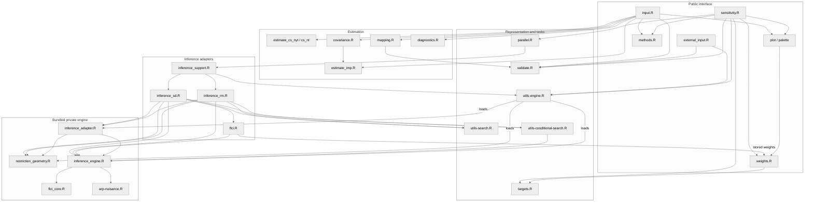
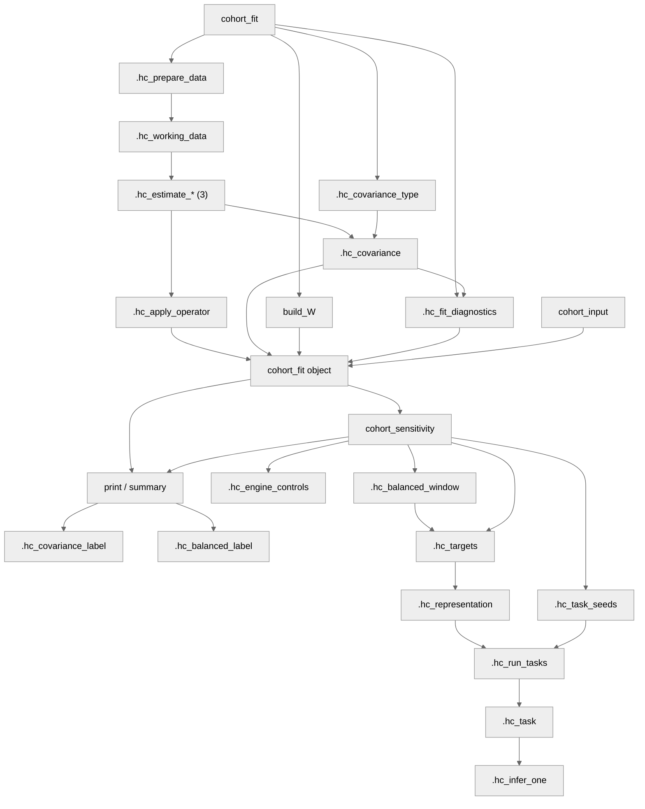
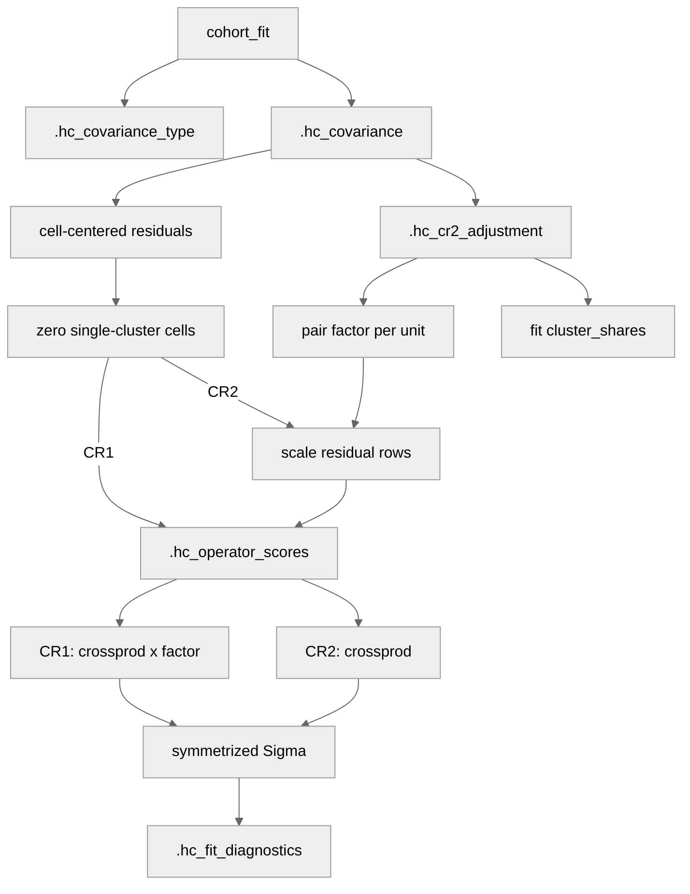
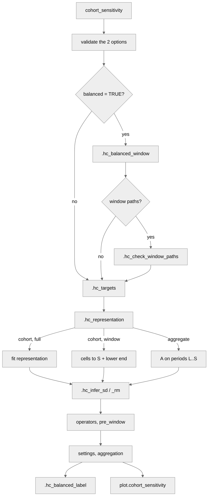
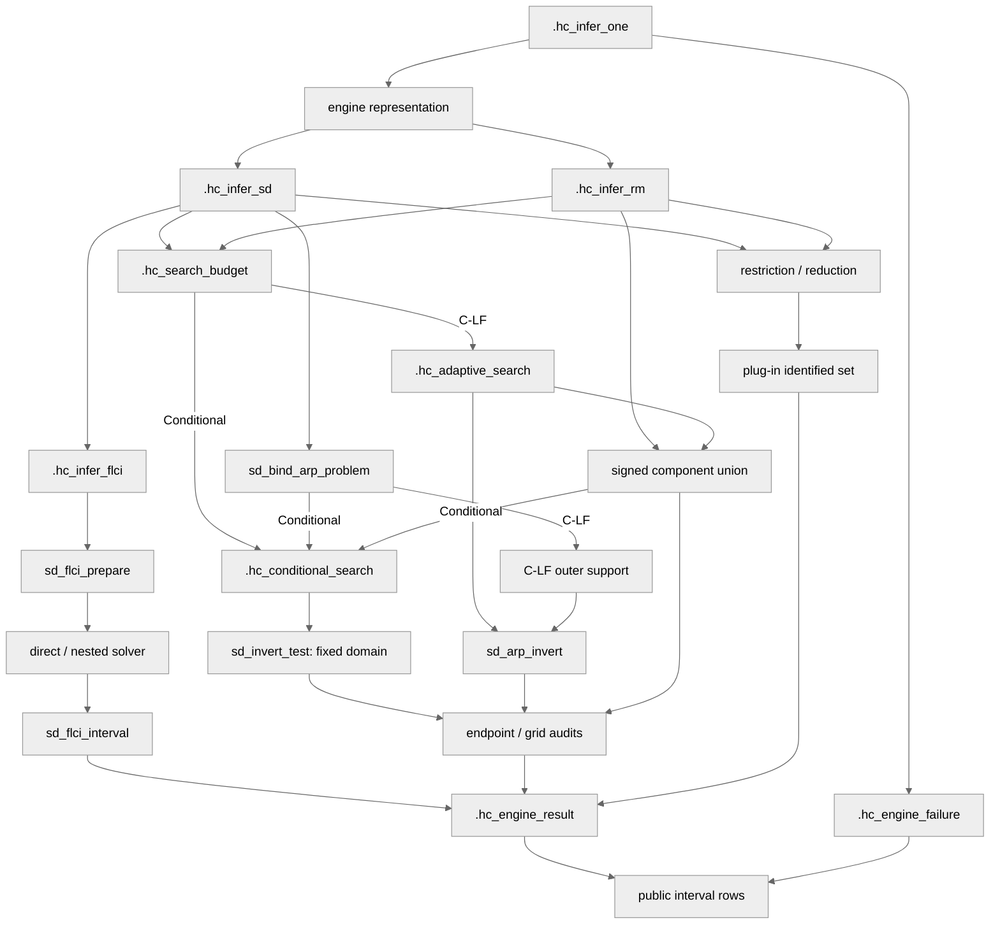
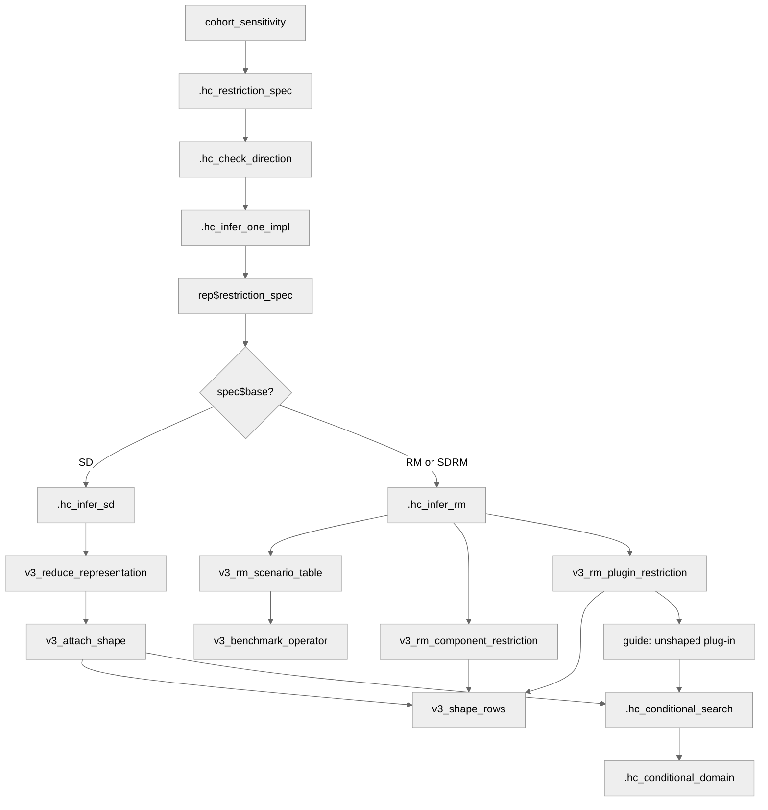
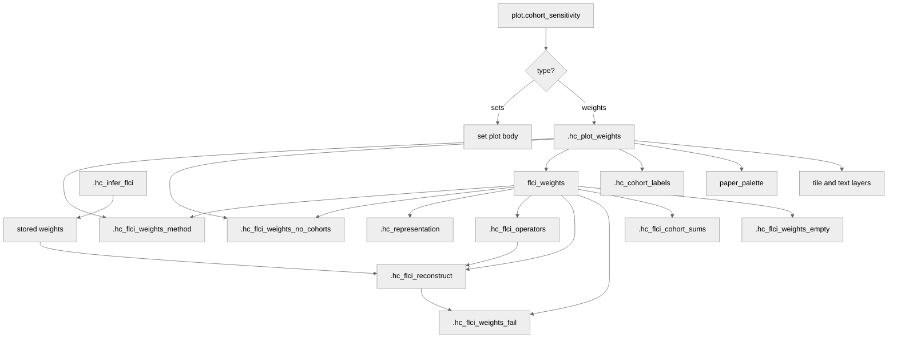
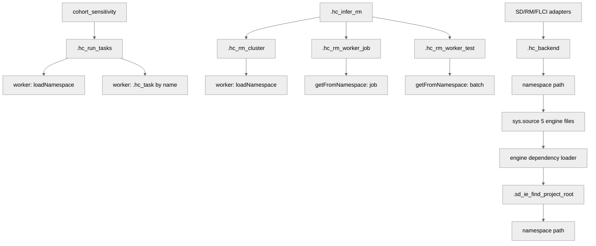
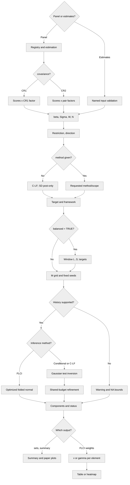

# Architecture — CohortHonestDiD

> Architecture of CohortHonestDiD 1.1.0. The diagrams below map the modules, the call chains from the exported
> functions to the bundled engine, and the data flow; a reference table follows each diagram.

## Overview

CohortHonestDiD implements cohort-anchored HonestDiD sensitivity analysis for difference-in-differences designs with
staggered adoption, as proposed in Liu (2026), "Cohort-Anchored HonestDiD" (arXiv:2509.01829). It estimates full
cohort-period coefficients and their joint cluster covariance, then applies the smoothness (SD) and
relative-magnitude (RM) restrictions of Rambachan and Roth (2023), or one of seven further restrictions built on them,
to each cohort's block bias through an estimator-specific bias map `W`.
The package accepts either a panel (`cohort_fit()`) or named external estimates
(`cohort_input()`). Both routes produce the same `cohort_fit` representation; `cohort_sensitivity()` returns every
confidence-set component together with explicit task statuses. Following the paper, `cohort_sensitivity()` uses the
C-LF procedure by default, under the post-only restriction for SD; FLCI and Conditional are available by name.
FLCI exists only under SD. SDB, SDM, RMB, RMM, SDRMB and SDRMM add sign or monotonicity rows, set by the last argument
`direction`, and SDRM applies RM to second differences. These seven run under Conditional and C-LF only, and the
paper's simulations do not cover them. "Restriction detail" below has the rows.
The covariance is the cluster-robust CR1 by default; `cohort_fit(covariance = "CR2")` gives the bias-reduced CR2
covariance of Bell and McCaffrey (2002), which the paper recommends with Conditional or C-LF inference when some
cohorts contain only a few units or clusters. With `cohort_sensitivity(balanced = TRUE)` the targets use only the
balanced window, the relative periods observed for every cohort, and aggregate inference forms the aggregated event
study only on that window, with cohort weights fixed across periods (balanced aggregation). Under cohort inference,
`cohort.paths` chooses whether the restriction uses each cohort's full path (`"full"`, the default) or only its part
inside the window (`"window"`). For FLCI results, `flci_weights()` tabulates the linear estimator's weights: the
weights `v` on the pre-treatment coefficients, in the paper's form `v = v^P + D'gamma` (the post-only weights plus a
combination of the pure pre-treatment second differences), or the weights `gamma` on those second differences, with
each weight's contribution to the FLCI center, by element or summed by cohort; `plot(result, type = "weights")` draws
them as a heatmap against the bound. The package is written in R (>= 4.1.0). `Matrix` supports sparse estimation,
`ggplot2` supplies plots, `parallel` and `withr` run reproducible worker tasks, and a bundled private numerical engine
under `inst/upstream/R/` uses the linear-programming (`Rglpk`, `lpSolveAPI`), normal-probability (`mvtnorm`,
`TruncatedNormal`) and matrix packages listed in Imports. The optional nested FLCI solver uses `CVXR` (Suggests),
through `flci_cvxr_run`, which serves CVXR versions before and after the change of the solve interface in 1.8.

### Repository layout

| Path | Contents | In the built package |
| --- | --- | --- |
| `DESCRIPTION`, `NAMESPACE` | Package metadata (MIT license); 6 exported functions, 10 registered S3 methods, imports | Yes |
| `R/` (24 files) | Package code; see Module Structure | Yes |
| `inst/upstream/R/` (5 files) | Bundled numerical engine, loaded at run time into a private environment | Yes |
| `inst/upstream/NOTICE`, `LICENSE-HonestDiD`, `LICENSE-HonestDiD-MIT` | Attribution and MIT notices for the routines adapted from HonestDiD | Yes |
| `inst/CITATION` | `citation("CohortHonestDiD")`: the paper and the package | Yes |
| `man/` (8 Rd files) | Help pages `cohort_fit`, `cohort_input`, `cohort_sensitivity`, `flci_weights`, `build_W`, `plot_cohort`, `paper_palette`, `minimum_wage`; the argument reference of the package | Yes |
| `data/minimum_wage.rda` | County panel of the minimum-wage application (15,988 rows, 28 columns) | Yes |
| [`vignettes/getting-started.Rmd`](vignettes/getting-started.Rmd) | Short walkthrough of the minimum-wage application with the defaults: estimation, the default C-LF analysis under SD, the other procedures and scopes (shown, not run; the FLCI paragraph points to `plot(flci, type = "weights")` and the detailed guide), dynamic and cohort-dynamic targets, the aggregate benchmark with a short paragraph on balanced aggregation (no chunk), RM (shown, not run) with a one-sentence pointer to the further restrictions, data requirements and diagnostics, a CR2 fit, and a short note on numerical results with pointers to the detailed guide and help pages for numerical controls and external estimates | Yes |
| [`vignettes/detailed-guide.Rmd`](vignettes/detailed-guide.Rmd) | Assumptions and terms; estimation with the three estimators; weights, clusters, panel histories and the CR2 covariance; targets and representations, with a full-path FLCI comparison, an executed balanced example on the minimum-wage fit (subsection "Balanced targets and balanced aggregation": cohort inference with full and window paths, and aggregate inference) and an executed FLCI weights example (subsection "FLCI weights": the post-only and full-path weights `v`, the weights `gamma` with cell labels, a table of centers and sums of contributions, and the cohort sums); procedures and SD scopes; RM; restrictions beyond SD and RM (section "Restrictions beyond SD and RM": the nine values, `direction`, SDB and SDM on the minimum-wage fit, empty and disconnected sets, the choice of procedure, RMB and RMM on the small artificial panel, SDRM and SDRMM on a longer artificial panel, case counts, and the comparison with HonestDiD); reading results (with a pointer to `flci_weights()`) and outcome statuses; numerical controls and FLCI solvers; external estimates and `W`; plots (with the weights heatmap). The procedure, RM, result-reading, control and external-input examples use a small artificial panel | Yes |
| `tests/testthat.R`, `tests/testthat/` (17 files) | testthat (edition 3) suite: fits, external input, sensitivity, default procedures, CR2 covariance, balanced targets and balanced aggregation, FLCI weights, RM, the seven further restrictions (with stored HonestDiD reference numbers), refinement, Conditional domains, boundaries, plots, method equivalence, session state, adversarial oracles | Yes |
| [`README.md`](README.md), `LICENSE` | Repository front page, CRAN-style license stub | Yes |
| [`NEWS.md`](NEWS.md) | Release notes, from 1.0.0 on | Yes |
| `LICENSE.md` | Full MIT license text | No (build-ignored) |
| `Architecture.md` | This file | No (build-ignored) |
| `data-raw/prepare-minimum-wage.R` | Adds the convenience aliases to the study input to produce `data/minimum_wage.rda`; the input file is not in the repository | No (build-ignored) |
| `_pkgdown.yml` | pkgdown configuration of the website https://lzy318.github.io/CohortHonestDiD/ (README as home page, the help pages, the two vignettes as articles); the site is built locally and published from the `gh-pages` branch | No (build-ignored) |
| `.Rbuildignore`, `.gitignore` | Build and Git exclusions | No |

---

## Module Structure

Arrows describe calls or data dependencies; `covariance.R` calls the operator-score helper in `estimate_imp.R`, which
serves all three estimators. `weights.R` reads FLCI results: the weights that `flci.R` stores in each result
("stored weights") and the representation that `targets.R` rebuilds; the weights plot in `plot.R` calls it. Bundled
engine files live under `inst/upstream/R/`; all other modules live under `R/`. The inference adapters reach engine
functions through the private environment that `utils-engine.R` builds ("loads" edges). The options and features
live in these files:

- `input.R`, `sensitivity.R`, `covariance.R` and `methods.R` hold the default procedure, the covariance option, the
  `balanced` and `cohort.paths` options, and the printed covariance and balanced-window lines;
- `targets.R` computes the balanced window, the balanced targets, the window-path cohort representation and the
  balanced aggregate representation; `plot.R` draws balanced results on the window and, with `type = "weights"`, the
  FLCI weights;
- `weights.R` holds `flci_weights()` and its helpers (see "FLCI weights detail" below); it only reads the weights
  that `flci.R` and the engine store;
- `inference_sd.R`, `inference_rm.R`, `restriction_geometry.R` and `inference_adapter.R` pass the window's lower end
  to the restriction operators under `cohort.paths = "window"` (see "Balanced detail" below);
- `inference_support.R` holds the list of restrictions and the `direction` check, `restriction_geometry.R` builds the
  sign, monotonicity and SDRM rows, and `inference_sd.R` and `inference_rm.R` attach them, as "Restriction detail"
  below shows;
- `parallel.R`, `utils-engine.R`, `inference_rm.R` and `inference_engine.R` are the four files that name the package
  at run time (see "Package-name lookups" below).

With the default `balanced = FALSE` the balanced code is not entered: the window is `NULL`, and the restriction
operators get `pre_window = NULL` and drop no row.

### Module Reference

| Module / File | Layer | Purpose | Key Exports |
| --- | --- | --- | --- |
| `R/input.R` | API | Validate and complete the panel registry; forward-fill D; prepare working weights and observations; validate the covariance option (`covariance = "CR1"`, after `...`) and record `covariance_convention` and, for CR2 fits, `cluster_shares`; documents `minimum_wage` | `cohort_fit` |
| `R/external_input.R` | API | Align named coefficients, covariance, `W` and normalization constraints; `vcov` is used as supplied | `cohort_input` |
| `R/sensitivity.R` | API | Validate options and resolve the method and scope defaults (`method = NULL` means C-LF under every restriction); check `direction` (last formal, default `NULL`); set up the balanced window (formals `balanced = FALSE` and `cohort.paths = NULL`, after `control`); form target/bound tasks; assemble public status and interval rows, the settings and, for balanced aggregate results, the `aggregation` element | `cohort_sensitivity` |
| `R/weights.R` | API | FLCI weights: for each target with weights, rebuild the representation the result used, build its second-difference operators, the post-only weights `v^P`, the estimated second differences and the post-only center in closed form, check them against the stored `gamma` and coefficient weights, and return `v = v^P + D'gamma` or `gamma` with estimates and contributions, by element or summed by cohort; helpers `.hc_flci_operators`, `.hc_flci_reconstruct`, `.hc_flci_cohort_sums`, `.hc_flci_weights_method`, `.hc_flci_weights_no_cohorts`, `.hc_flci_weights_fail` and `.hc_flci_weights_empty`; constants `.hc_weights_rank_tolerance` (1e-10) and `.hc_weights_check_tolerance` (1e-8) | `flci_weights` |
| `R/estimate_imp.R` | Estimation | Sparse outcome operator and untreated unit/time fixed-effect correction; operator application and cluster scores | None |
| `R/estimate_cs_nyt.R`, `R/estimate_cs_nt.R` | Estimation | Weighted paired long differences with not-yet-treated or never-treated comparisons | None |
| `R/covariance.R` | Estimation | Covariance option validation (`.hc_covariance_type`); cohort-period centering, cluster scores, and the CR1 or CR2 covariance (`.hc_covariance`, argument `type`); exact zero scores for single-cluster cells; CR2 shares and factors of (cluster, cohort group) pairs (`.hc_cr2_adjustment`) | None |
| `R/mapping.R` | Estimation | Full bias map using scale-stable cohort-mass ratios | `build_W` |
| `R/diagnostics.R` | Estimation | Observation, cohort, cluster, normalization and covariance diagnostics; stores the CR1 factor (`NA` under CR2) | None |
| `R/validate.R` | Representation | Input assertions, estimator aliases, coordinate registry, normalization and cell checks | None |
| `R/targets.R` | Representation | Balanced window (`.hc_balanced_window`, `.hc_check_window_paths`); ATT/dynamic/cohort-dynamic weights (`.hc_targets`, argument `window`); the cohort (full or window paths) and aggregate representations (`.hc_representation`, arguments `window` and `paths`) | None |
| `R/parallel.R` | Tasks | Fixed task seeds, serial/socket dispatch and worker cleanup | None |
| `R/utils-engine.R` | Representation | Numerical controls, alignment to canonical coordinates, regular grid with optional certified bounds, result/failure constructors, private engine loading from the namespace path | None |
| `R/utils-search.R` | Tasks | Shared point-evaluation budget and cache; eligible refinements and attempt diagnostics | None |
| `R/utils-conditional-search.R` | Tasks | Conditional domain construction (linear continuation for the bases SD and SDRM, constant for RM), bilateral expansion, interior and endpoint audits, remembered acceptance checks and range diagnostics | None |
| `R/inference_support.R` | Inference | The nine restriction names, `.hc_restriction_spec` and `.hc_check_direction`; common task entry; prehistory and deterministic-target checks; dispatch on `spec$base` | None |
| `R/inference_sd.R` | Inference | SD, SDB and SDM: the SD restriction, the sign or monotonicity rows attached after the reduction, and the plug-in set; FLCI, Conditional or C-LF; C-LF support bounds prepared once for all attempts; passes the representation's `restriction_window` to `v3_sd_restriction` as `pre_window` | None |
| `R/flci.R` | Inference | FLCI rule and interval adapter; stores each result's `weights` (`gamma` and the coefficient weights), which `flci_weights()` reads | None |
| `R/inference_rm.R` | Inference | The union path, for the bases RM and SDRM: signed components, optional component workers and component union; under window paths, counts the signed components from the benchmarks inside the window and passes `pre_window` to the scenario table and the plug-in restriction; gives the Conditional search the unshaped plug-in set as `guide` | None |
| `inst/upstream/R/restriction_geometry.R` | Private engine | Coordinate parsing, first/second differences, SD and RM restriction matrices, signed scenarios; sign and monotonicity rows (`v3_shape_rows`, `v3_attach_shape`) and the RM or SDRM benchmark operator (`v3_benchmark_operator`), see "Restriction detail"; the optional argument `pre_window = NULL` of `v3_first_difference_operator`, `v3_second_difference_operator`, `v3_sd_restriction`, `v3_rm_scenario_table`, `v3_rm_component_restriction` and `v3_rm_plugin_restriction` drops only pure pre-treatment rows that reach before the window | None |
| `inst/upstream/R/inference_adapter.R` | Private engine | Normalization reduction, plug-in sets, ARP geometry, union calculations, reusable support context and budgeted sentinel tests; `v3_prepare_rm_union` and `v3_clf_rm_union` pass `restriction_window` and `restriction_spec` to the scenario table and plug-in restriction, and the latter allows an empty plug-in set | None |
| `inst/upstream/R/inference_engine.R` | Private engine | FLCI preparation, Gaussian tests, confidence-set inversion with explicit expansion spacing, endpoint and topology audits; loads the FLCI core and HonestDiD routines | None |
| `inst/upstream/R/flci_core.R` | Private engine | Folded-normal objective, direct/nested optimization and PSD limits; `flci_cvxr_run`, the one call into CVXR's solve function | None |
| `inst/upstream/R/arp-nuisance.R` | Private engine | Gaussian moment-inequality (ARP) calculations adapted from HonestDiD | None |
| `R/methods.R` | Output | S3 accessors; print/summary with the restriction label (`.hc_restriction_label`), the covariance label (`.hc_covariance_label`; summary objects end with `covariance`) and, for balanced results, the balanced-window line (`.hc_balanced_label`); Conditional searched-range tables | `coef`, `vcov`, `print` and `summary` methods |
| `R/plot.R`, `R/palette.R` | Output | Component-preserving plots and paper colors; restriction, bounded-search and balanced-window plot captions; FLCI weights heatmap (`type = "weights"`, drawn by `.hc_plot_weights`) | `plot` methods; `paper_palette` |
| `R/imports.R`, `NAMESPACE`, `DESCRIPTION` | Package | Import declarations, exports, S3 registrations and metadata | 6 exported functions |
| `data/`, `man/`, `vignettes/`, `README.md`, `NEWS.md`, `inst/CITATION` | Data/docs | Application data, help pages, two vignettes, front page, release notes, citation | `minimum_wage` data |
| `tests/testthat.R`, `tests/testthat/` | Tests | Regression and independent public-interface checks | None |

---

## Function Call Graph

### Estimation and dispatch

Arrows follow the order of calls and the objects they produce. `cohort_fit` passes the validated covariance type to
`.hc_covariance` and the covariance list it returns to `.hc_fit_diagnostics`. `.hc_balanced_window` runs only with
`balanced = TRUE`; its window is passed to `.hc_targets` and `.hc_representation` (see "Balanced detail").

| Function | Defined In | Called By | Calls | Purpose |
| --- | --- | --- | --- | --- |
| `cohort_fit` | `input.R` | User | Covariance-type check, preparation, estimation, covariance, mapping and diagnostics | Construct the fitted representation once; `covariance` (default `"CR1"`, after `...`) sets `covariance_convention` and, for CR2 fits, `cluster_shares` |
| `.hc_covariance_type` | `covariance.R` | `cohort_fit` | `.hc_assert` | Accept `"CR1"` or `"CR2"` in any case and return it in upper case; anything else errors with "covariance must be 'CR1' or 'CR2'." |
| `.hc_prepare_data`, `.hc_working_data` | `input.R` | `cohort_fit` | Validation and registry helpers | Forward-fill D, retain usable Y, record any common weight divisor, require two clusters (the error names CR1 or CR2), compress balanced panels to cohort-period cells |
| `.hc_estimate_imp`, `.hc_estimate_cs_nyt`, `.hc_estimate_cs_nt` | Estimator files | `cohort_fit` | Sparse operator helpers | Construct the outcome contrast operator |
| `.hc_covariance` | `covariance.R` | `cohort_fit` | `.hc_cr2_adjustment` (CR2 only), `.hc_operator_scores` | Full joint covariance from centered cluster scores; `type` selects CR1 or CR2 (see "Covariance detail") |
| `build_W` | `mapping.R` | User / `cohort_fit` | `create_delta_to_Delta_mapping_matrix` | Map primitive deviations to coefficient bias |
| `.hc_fit_diagnostics` | `diagnostics.R` | `cohort_fit` | Cohort, cell and eigenvalue summaries | Support and covariance diagnostics stored on the fit, computed from whichever `Sigma` was estimated |
| `cohort_input` | `external_input.R` | User | `.hc_check_mapping_support` and validation | Construct the same object from external estimates; the supplied `vcov` is used as given |
| `cohort_sensitivity` | `sensitivity.R` | User | Direction check, controls, balanced window, targets, representations, seeds and task runner | Resolve `method` (NULL means C-LF) and, for SD, SDB and SDM, `full.path` (NULL means TRUE only for FLCI); with `balanced = TRUE`, validate `cohort.paths` (NULL means `"full"` under cohort inference), compute the window and record it; return estimates and all confidence-set components |
| `.hc_balanced_window` | `targets.R` | `cohort_sensitivity` (balanced only) | None | The balanced window `c(lower = L, upper = S)` from `coordinate_info` (see "Balanced detail") |
| `.hc_check_window_paths` | `targets.R` | `cohort_sensitivity` (`cohort.paths = "window"` only) | None | Reject a `W` or normalization that links a kept coefficient to one after the window |
| `.hc_targets`, `.hc_representation` | `targets.R` | `cohort_sensitivity` | Mass normalization and matrix transforms | Preserve the requested estimand across frameworks; with a `window` (both functions; `NULL` unless `balanced = TRUE`), restrict targets to periods 1 to `S`, form the aggregate path on `L` to `S`, or, under window paths (argument `paths` of `.hc_representation`), drop the post-treatment coefficients after `S` |
| `.hc_task_seeds` | `parallel.R` | `cohort_sensitivity` | None | Deterministic per-task seeds, independent of worker count |
| `.hc_run_tasks`, `.hc_task` | `parallel.R` | `cohort_sensitivity` | `.hc_infer_one`, `withr`, `parallel` | Reproducible execution with worker cleanup |
| `print.cohort_fit`, `summary.cohort_fit`, `print.summary_cohort_fit`, `print.cohort_sensitivity`, `summary.cohort_sensitivity`, `print.summary_cohort_sensitivity` | `methods.R` | User | `.hc_restriction_label`, `.hc_covariance_label`, `.hc_balanced_label`; searched-range helpers | Printed headers name the restriction and its direction, the procedure, scope and covariance, and for balanced results the window |
| `.hc_restriction_label` | `methods.R` | `print.cohort_sensitivity`, `plot.cohort_sensitivity` | None | The restriction name, followed by `, <direction>` when `settings` holds one |
| `.hc_covariance_label` | `methods.R` | Print and summary methods | None | `CR1 cluster-robust, G clusters`, `CR2 bias-reduced cluster-robust, G clusters`, `supplied to cohort_input()` for external input, or `not recorded` |
| `.hc_balanced_label` | `methods.R` | `print.cohort_sensitivity`, `print.summary_cohort_sensitivity` (balanced only) | None | `Balanced window: relative periods L to S; target period 1` (or `target periods 1 to S`), then `; cohort paths: full`, `; cohort paths: window` or `; aggregate path on the window` |

### Covariance detail

The pair factors and the row scaling exist only for `covariance = "CR2"`; `.hc_cr2_adjustment` runs before the
residual matrix is built, and its shares become the fit's `cluster_shares`.

| Step | Defined In | Called By | Calls | Purpose |
| --- | --- | --- | --- | --- |
| Cell-centered residuals | `covariance.R` | Step of `.hc_covariance` | `rowsum` | Residual = outcome minus the weighted mean of its cohort-period cell, over usable rows |
| Residual-by-cluster matrix | `covariance.R` | Step of `.hc_covariance` | `Matrix::sparseMatrix` | Balanced panels: one row per cohort-period cell of the compressed working data, holding each cluster's weighted residual sum divided by the cell mass; unbalanced panels: one row per usable observed row, holding its residual |
| Zero single-cluster cells | `covariance.R` | Step of `.hc_covariance` | None | Balanced (compressed) path only: a cell supported by a single cluster gets exactly zero entries, without a variance cutoff. The observed-row path for unbalanced panels has no such step |
| `.hc_cr2_adjustment` | `covariance.R` | `.hc_covariance` (CR2) | Base R (`match`, `tabulate`, `rowsum`) | Pairs (cluster, cohort group) from `prepared$unit_registry`, the never-treated units forming group 0; pair share p = pair weight / group weight (unit counts when unweighted); factor `1/sqrt(1 - p)`, computed as `sqrt(total/rest)`; factor 0 for a pair that holds every unit of its group; returns the `cluster_shares` data frame and one factor per unit |
| Scale residual rows | `covariance.R` | Step of `.hc_covariance` (CR2) | None | Multiply each row by the factor of its unit's pair. A compressed row is one cell of one group, so every entry of the matrix is scaled by exactly one pair factor |
| `.hc_operator_scores` | `estimate_imp.R` | `.hc_covariance` | Sparse products with the operator and its fixed-effect correction | Apply the estimator's linear operator to every cluster column; rows of the result are the cluster scores (`fit$cluster_scores`) |
| CR1 / CR2 sum | `covariance.R` | Step of `.hc_covariance` | `crossprod` | CR1: cross-product times `G/(G - 1) * (n - 1)/(n - p)` (G clusters, n usable rows, p nonempty cells); CR2: cross-product with no factor and `cr1 = NA` |
| Symmetrized `Sigma` | `covariance.R` | Step of `.hc_covariance` | None | `(Sigma + t(Sigma))/2` with coordinate names; returned with the scores, the factor, the counts and, under CR2, the shares |

### Balanced detail

The task runner and `.hc_infer_one` between the representation and the inference adapters are omitted. With
`balanced = FALSE`, `.hc_targets` and `.hc_representation` receive `window = NULL` and `paths = "full"`: the
targets use every post-treatment cell, the cohort representation is the fit's own, and the aggregate branch uses
every observed relative period. Under `cohort.paths = "full"` the cohort representation is the same as with
`balanced = FALSE`; only the target differs.

| Step | Defined In | Called By | Calls | Purpose |
| --- | --- | --- | --- | --- |
| Option validation | `sensitivity.R` | `cohort_sensitivity`, after its other argument checks and `.hc_engine_controls` | None | `balanced` must be one non-missing logical; `cohort.paths` may be supplied only with `balanced = TRUE` and `framework = "cohort"`, and must then be exactly `"full"` or `"window"` (no partial matching); `NULL` means `"full"` under balanced cohort inference |
| `.hc_balanced_window` | `targets.R` | `cohort_sensitivity` | None | From `coordinate_info` (so also for `cohort_input()` objects and unbalanced panels): `S` = the largest `s >= 1` such that periods `1..s` are observed for every cohort, `L` = the smallest `s <= 0` such that periods `s..0` are; returns the named integer `c(lower = L, upper = S)`. Errors if some cohort lacks relative period 1 (checked first) or relative period 0, which is possible only for `cohort_input()` objects. For a `cohort_fit` with adoption indices `t_1 < ... < t_G` on `T` periods, `L = 2 - t_1` and `S = T - t_G + 1` |
| `.hc_check_window_paths` | `targets.R` | `cohort_sensitivity` (`cohort.paths = "window"`) | None | Error if a kept row of `W`, or a normalization row, loads on a post-treatment coefficient after `S` (scale-relative tolerance 1e-12). The bias maps that `cohort_fit()` builds never do, so only `cohort_input()` objects can fail |
| `.hc_targets(fit, target, window)` | `targets.R` | `cohort_sensitivity` | Its local `make()` (relative masses, then normalized) | Keeps the post cells with `s <= S` before the weight arithmetic: the ATT weights each cell of periods 1 to `S` by `m_g / (S * sum m)`, dynamic targets exist for `s = 1..S` with weights `m_g / sum m`, and cohort-dynamic targets for the cells with `s <= S`. Weight vectors still cover every coefficient of `fit`. ATT label `Average treatment effect, relative period 1` (`S = 1`) or `..., relative periods 1 to S` |
| `.hc_representation(fit, ell, framework, window, paths)` | `targets.R` | `cohort_sensitivity`, once per target | `qr.solve`, null-space embedding | Cohort, `"full"`: the fit's own representation. Cohort, `"window"`: keeps every pre-treatment coefficient and the post-treatment coefficients up to `S` (`betahat`, `Sigma`, `W`, `normalization` and the target subset to them) and adds the element `restriction_window = L`. Aggregate: the construction used without a window, on the period set `L..S` |
| `.hc_infer_sd`, `.hc_infer_rm` | `inference_sd.R`, `inference_rm.R` | `.hc_infer_one` | Restriction operators of the engine | Read `representation[["restriction_window"]]` (absent, hence `NULL`, except under window paths) and pass it as `pre_window`; `.hc_infer_rm` also counts the signed components from the pre-treatment cells at or after `L` |
| Restriction operators | `restriction_geometry.R` | SD/RM adapters; `v3_prepare_rm_union`, `v3_clf_rm_union` | None | Optional argument `pre_window` (`L`, or `NULL` to drop nothing): `v3_first_difference_operator` drops pre-treatment first differences whose earlier period is before `L` (RM benchmark candidates); `v3_second_difference_operator` drops pure pre-treatment second differences whose first period is before `L` (full-path SD). Rows that involve a post-treatment coefficient are never dropped. `v3_sd_restriction`, `v3_rm_scenario_table` and `v3_rm_plugin_restriction` pass the argument on; `v3_rm_component_restriction` uses it only when it builds the operator itself (the RM adapter passes it the windowed operator of the scenario table) |
| `v3_prepare_rm_union`, `v3_clf_rm_union` | `inference_adapter.R` | RM C-LF adapter | Scenario table, plug-in restriction | Pass `representation[["restriction_window"]]`; `v3_align_representation` keeps the element |
| Settings and `aggregation` | `sensitivity.R` | `cohort_sensitivity` | None | Only when `balanced = TRUE`: `settings` ends with `balanced`, `cohort.paths` and `window`, and aggregate results end with the element `aggregation` (see Notes). Estimates use the full-length target with the fit's `betahat` and `Sigma` in every case |
| `.hc_balanced_label` | `methods.R` | Print methods | None | One line after `Covariance:` in `print()`, and the second line of `print(summary())` followed by a blank line |
| `plot.cohort_sensitivity` | `plot.R` | User | `.hc_event_data` | Caption sentence `Balanced window: relative periods L to S; cohort paths: P.` (cohort) or `Balanced window: relative periods L to S.` (aggregate); dynamic and cohort-dynamic plots draw the conventional points only for `s = L..S`; on the window the aggregated points of a dynamic plot are the balanced aggregated coefficients (`aggregation$betahat` for aggregate results) |

### Inference detail

Under `cohort.paths = "window"`, `.hc_infer_sd` and `.hc_infer_rm` pass the window's lower end
(`restriction_window`) to the restriction operators; for every other representation the element is absent and no
row is dropped. SD, SDB and SDM take the `.hc_infer_sd` branch, and the bases RM and SDRM take `.hc_infer_rm`.
A call without `method` takes the C-LF branch. Inference uses the covariance only through the
fit's `Sigma`, so CR1 and CR2 fits use the same code. A balanced aggregate representation enters this diagram like
any other aggregate representation.

| Function | Defined In | Called By | Calls | Purpose |
| --- | --- | --- | --- | --- |
| `.hc_infer_one` | `inference_support.R` | Task runner | SD/RM adapters or explicit failure constructor | Check prehistory and supported stochastic quantities; set `restriction_spec` and dispatch on its base |
| `.hc_engine_representation`, `.hc_backend` | `utils-engine.R` | Inference adapters | Private alignment; engine loading from the namespace path | Keep helpers private; support both installed and source-loaded resources |
| `.hc_infer_sd` | `inference_sd.R` | Common task entry | Restriction/reduction, `v3_attach_shape`, plug-in, FLCI or shared-budget Gaussian inversion; C-LF support LP | Apply either SD scope to SD, SDB and SDM; prepare, calibrate and bound support once for all search attempts; pass `restriction_window` to `v3_sd_restriction` as `pre_window` |
| `.hc_infer_rm` | `inference_rm.R` | Common task entry | Signed-component geometry, prepared support context and shared-budget union inversion | Serve the bases RM and SDRM; preserve disconnected sets, calibration and worker state across retries; under window paths, count the signed components inside the window and pass `pre_window` to the scenario table and plug-in restriction |
| `.hc_search_budget` | `utils-search.R` | SD/RM adapters | Cached point-test callback | Count distinct test evaluations across searches, probes, audits and retries |
| `.hc_adaptive_search` | `utils-search.R` | SD/RM C-LF adapters | Per-attempt inversion callback | Double regular grid intervals for eligible unresolved statuses within the limits |
| `.hc_conditional_domain`, `.hc_conditional_search` | `utils-conditional-search.R` | SD/RM Conditional adapters | Cached point tests, fixed-domain inversion and endpoint audits | Search concentric domains with fixed regular spacing and require two successive adjacent-domain agreements; finer retries reuse the same cache and visited-range history |
| `.hc_engine_grid` | `utils-engine.R` | SD/RM adapters | Regular grid/profile anchors, with optional certified bounds | Carry regular spacing separately; pad supplied C-LF support by the endpoint probe margin |
| `.hc_infer_flci` | `flci.R` | SD adapter | `sd_flci_prepare`, `sd_flci_interval` | Expose the optimized rule and interval diagnostics (including `tie.break`); store `weights$gamma` and `weights$coefficients`, the weights mapped back from the reduced space to the representation's coordinates (read by `flci_weights()`, see "FLCI weights detail") |
| `sd_flci_prepare` | Private `inference_engine.R` | FLCI adapter | Private direct/nested FLCI solvers | Handle PSD and exact zero-noise limits without jitter |
| `sd_bind_arp_problem`, `sd_arp_invert` | Private `inference_engine.R` | SD/RM adapters | Gaussian tests, calibration, explicit expansion spacing and shared point tests | Compute Conditional/C-LF sets without resimulating calibration on retry |
| `v3_clf_rm_union`, `v3_memoize_rm_union_test`, `v3_rm_verify_support_sentinels` | Private `inference_adapter.R` | RM adapter | Prepared component/support context, cached union tests and separately keyed sentinel tests | Reuse RM calibration and account for actual point work across refinements; `v3_clf_rm_union` and the `v3_prepare_rm_union` it calls pass `restriction_window` to the scenario table and plug-in restriction |
| `v3_rm_lf_component_support` | Private `inference_adapter.R` | RM adapter and SD C-LF | Primal/dual-checked support endpoint LPs | Bound the necessary LF first-stage support with the realized cutoff |
| `.hc_engine_result`, `.hc_engine_failure` | `utils-engine.R` | Inference adapters | Component/status assembly | Keep empty, unbounded, disconnected and unsupported results distinct |

### Restriction detail

`spec` is the list `(restriction, base, shape, direction)`. The base chooses the rows and the code path. `"SD"` serves
SD, SDB and SDM on the SD path, `.hc_infer_sd`. `"RM"` serves RM, RMB and RMM, and `"SDRM"` serves SDRM, SDRMB and
SDRMM, both on the union path, `.hc_infer_rm`. The shape is `"none"`, `"sign"` or `"monotone"`. The spec reaches the engine as
`representation$restriction_spec`, the way `restriction_window` does, so nothing depends on session state on a worker.
`v3_align_representation` and `.hc_engine_representation` keep the field. The diagram omits FLCI, which the entry
refuses for every restriction but SD, and the C-LF branch, which reads the same field through `v3_clf_rm_union`.

**What is computed.** All rows act on the block-bias path `Delta` as `A_Delta %*% Delta <= d`, per cohort `g` and with
one direction for all cohorts. The relative period `s = 1` is the first treated period and `s = 0` the last untreated one.

| Part | Rows | Goes with |
| --- | --- | --- |
| SD rows | `+-(Delta(g,s) - 2 Delta(g,s-1) + Delta(g,s-2)) <= M` for `s >= 1`; with `full.path = TRUE` also for `s <= 0` | Base SD |
| RM rows | `+-(Delta(g,s) - Delta(g,s-1)) <= M * b_g` for `s >= 1`, with `b_g` a signed pure pre-treatment first difference; union over the signed choices | Base RM |
| SDRM rows | `+-(Delta(g,s) - 2 Delta(g,s-1) + Delta(g,s-2)) <= M * b_g` for `s >= 1`, with `b_g` a signed pure pre-treatment second difference; union over the signed choices | Base SDRM |
| Sign rows | positive: `Delta(g,0) - Delta(g,s) <= 0`; negative: reversed; for every `s >= 1` | Shape sign |
| Monotonicity rows | increasing: `Delta(g,s-1) - Delta(g,s) <= 0`; decreasing: reversed; for `s >= 1`; with `full.path = TRUE` (SDM only) also for `s <= 0` | Shape monotone |

With `n_g` pre-treatment coefficients of cohort `g` inside the window, `s = 0` included, the base RM has
`prod(2 * (n_g - 1))` signed components and the base SDRM `prod(2 * (n_g - 2))`; at `M = 0` there is one. In the
minimum-wage application, with pre-treatment counts 3, 5 and 6, that is 320 and 96 on full paths, 64 and 8 on window
paths, and 10 and 8 under aggregate inference.

| Function | Defined In | Called By | Calls | Purpose |
| --- | --- | --- | --- | --- |
| `.hc_restrictions`, `.hc_restriction_spec` | `inference_support.R` | `cohort_sensitivity`, `.hc_infer_one_impl`, print and plot methods | None | The nine names, and the map from a name and direction to `spec` |
| `.hc_check_direction` | `inference_support.R` | `cohort_sensitivity` | None | Before any task starts: a shaped restriction requires a matching `direction`, and the others require `NULL` |
| `.hc_infer_one_impl` | `inference_support.R` | `.hc_infer_one` | `.hc_infer_sd`, `.hc_infer_rm`, `.hc_engine_failure` | Refuse FLCI outside SD; set `topology.audit = FALSE` under Conditional for a shaped restriction unless the user named the key; require three pre-treatment coefficients for the base SDRM; set `rep$restriction_spec`; record `diagnostics$direction` |
| `v3_shape_rows` | `restriction_geometry.R` | `v3_attach_shape`, `v3_rm_component_restriction`, `v3_rm_plugin_restriction` | `v3_first_difference_operator` | The sign or monotonicity rows of the table above, or `NULL` for shape `"none"`. `full_path` adds the pure pre-treatment steps of a monotonicity restriction; only `v3_attach_shape` passes it, so only SDM has them |
| `v3_attach_shape` | `restriction_geometry.R` | `.hc_infer_sd` | `v3_shape_rows` | Append the rows to `restriction$A_Delta` and `d_vec` after `v3_reduce_representation`, which keeps the SD reduction and its `model$B_Q` |
| `v3_benchmark_operator` | `restriction_geometry.R` | `v3_rm_scenario_table`, `v3_rm_component_restriction`, `v3_rm_plugin_restriction` | `v3_first_difference_operator`, `v3_second_difference_operator` | First differences for the base RM. For the base SDRM, second differences under the same names (`D1`, `rows`, `component` `"pre"` or `"post"`), so `v3_rm_preferred_component` needs no change |
| `v3_rm_scenario_table`, `v3_rm_plugin_restriction` | `restriction_geometry.R` | Union path, `v3_prepare_rm_union`, `v3_clf_rm_union` | `v3_benchmark_operator`, `v3_shape_rows` | Take `spec`; the plug-in restriction appends the shape rows with zero bounds |
| `v3_rm_component_restriction` | `restriction_geometry.R` | `.hc_rm_component_job`, `v3_prepare_rm_union` | `v3_benchmark_operator`, `v3_shape_rows` | Takes `spec`, appends the shape rows and removes exact repeated rows (see "Architectural Patterns") |
| `.hc_infer_rm` | `inference_rm.R` | `.hc_infer_one_impl` | Geometry above, `v3_reduce_polyhedral_representation`, `v3_plugin_identified_set`, `.hc_conditional_search` | Count the signed components by base and stop above `max.components`; compute the shaped plug-in set for reporting and, for a shaped restriction, the unshaped one as `guide` |
| `.hc_conditional_domain`, `.hc_conditional_search` | `utils-conditional-search.R` | SD and union paths | Point tests | The domain takes the base as `restriction`, with a linear continuation for SD and SDRM and a constant one for RM. `guide` (default `plugin`) feeds only the domain; every other use reports the shaped plug-in set |
| `.hc_restriction_label` | `methods.R` | Print and plot methods | None | See "Restriction labels" in Notes |
| `flci_cvxr_run` | `flci_core.R` | `flci_cvxr_solve`, `.maxBiasFN`, `.minBiasFN` | CVXR | Call `solve` when CVXR exports it; otherwise call `psolve` and read the status and values through `status` and `value`. It returns the old list form in both cases |

### FLCI weights detail

`flci_weights()` is the public entry point; the weights plot calls it after its own argument checks. The extractor
only reads the result: it calls `.hc_representation` with the result's own settings, so it sees the representation
the FLCI used, and it accepts the weights that `.hc_infer_flci` stored ("stored weights") only after reconstructing
them. The set plot (`type = "sets"`, the default) draws the confidence sets; see "Balanced detail" for its
balanced-window caption.

**What is computed.** For one target, the representation gives the coefficients `b` (`betahat`), the bias map `W`,
the target weights `l` and the normalization `N`: under cohort inference those of the fit (or, under
`cohort.paths = "window"`, of the window-path cells, with the window's lower end `L`); under aggregate inference
those of the aggregated path (one internal path `g1`, `W = I`, target `l_A`). `P` and `Q` are its pre- and
post-treatment cells, each ordered by cohort and then by relative period.

- Second differences along each path, whose relative periods are consecutive: from the third cell on, the row
  `d_{g,e}` has `+1` at `(g, e)`, `-2` at `(g, e - 1)` and `+1` at `(g, e - 2)`. Rows with `e <= 0` are the pure
  pre-treatment second differences (under `cohort.paths = "window"` only those with `e - 2 >= L`, the rows of the
  windowed restriction); their columns on `P` form `D_PP` (`J` rows, ordered by cohort and then `e`, which is the
  engine's order of `gamma`; element names `d2_g<g>_s<e>`). Rows with `e >= 1` are post-connected, one per post
  cell, ordered like `Q`; their columns form `D_QP` and the unit lower-triangular `D_QQ`.
- `xi = solve(t(D_QQ), t(W_QQ) %*% l_Q)` and `vP = t(D_QP) %*% xi - t(W_QP) %*% l_Q`: the post-only weights on the
  pre-treatment coefficients (paper `v^P`). They subtract each cohort's linear extrapolation from its last two
  pre-treatment periods and, under CS-NYT, undo the base-period correction of `W`; they do not depend on `M`.
- `zhat = D_PP %*% b_P` (the estimated pure pre-treatment second differences) and the post-only center
  `c0 = sum(vP * b_P) + sum(l_Q * b_Q)`.
- For each task with weights: `gamma` is the stored `weights$gamma` (zeros for the post-only FLCI) and
  `v = vP + t(D_PP) %*% gamma` (paper `v = v^P + D'gamma`).
- Checks before anything is reported: `length(gamma) == J`; if the engine named `gamma` (it does so on its analytic
  `M = 0` branch), the names are `d2_g<g>_s<e>_pos` in the same order; and `Pi %*% v` equals the stored
  `weights$coefficients` on `P` within `1e-8 * max(1, max|w_P|)`, where `Pi` is the orthogonal projector onto the null
  space of the normalization's pre-treatment columns (QR rank tolerance 1e-10). Any failure stops with the
  reconstruction error.
- Contributions are `weight * estimate`. They add up to `center - c0` over the `gamma` rows and to
  `center - estimate` (the conventional estimate) over the `v` rows of a task.

| Function | Defined In | Called By | Calls | Purpose |
| --- | --- | --- | --- | --- |
| `flci_weights(x, weights, by)` | `weights.R` | User; `.hc_plot_weights` | The checks below, `.hc_representation`, `.hc_flci_operators`, `.hc_flci_reconstruct`, `.hc_flci_cohort_sums`, `.hc_flci_weights_empty`, `.hc_flci_weights_fail` | Check the object, method and framework; loop over targets `j` and bounds `m` (task `k = (j - 1) * length(settings$M) + m`); list tasks without weights in `missing`; rebuild the operators once per target that has weights; one `centers` row and the element rows per task with weights; return the data frame with its attributes (see Notes). It never messages or warns |
| `.hc_flci_weights_method` | `weights.R` | `flci_weights`, `.hc_plot_weights` | None | Error unless `settings$method` is `"flci"`; the message names Conditional or C-LF |
| `.hc_flci_weights_no_cohorts` | `weights.R` | `flci_weights`, `.hc_plot_weights` | None | Error for `by = "cohort"` under aggregate inference |
| `.hc_representation` | `targets.R` | `cohort_sensitivity`; `flci_weights` | See "Balanced detail" | Called with `settings$window` and, for balanced cohort inference, `settings$cohort.paths` (otherwise `"full"`), as `cohort_sensitivity()` called it |
| `.hc_flci_operators` | `weights.R` | `flci_weights`, once per target with weights | `solve`, `qr`, `crossprod` | Second-difference rows (pure, post-connected, or outside the window), `D_PP`, `xi`, `vP`, `zhat`, `c0`, `Pi`, and the labels of the coefficient and second-difference rows. Errors, which `flci_weights` turns into the reconstruction error, if a post cell has no post-connected row, the triangular solve fails or a value is not finite |
| `.hc_flci_reconstruct` | `weights.R` | `flci_weights`, once per task with weights | `.hc_flci_weights_fail` | The checks above; returns `v` named by the pre-treatment coordinates |
| `.hc_flci_cohort_sums` | `weights.R` | `flci_weights` (`by = "cohort"`), once per task | None | Per cohort with at least one row: `elements`, `weight` (sum), `l1` (sum of absolute weights), `share` (`l1` over the task's total, `NA` when that is 0), `contribution` (sum), `tie.break` |
| `.hc_flci_weights_empty`, `.hc_flci_weights_fail` | `weights.R` | `flci_weights`, `.hc_flci_reconstruct` | None | The 0-row data frame with the documented columns and types; the reconstruction error |
| `.hc_infer_flci` | `flci.R` | SD adapter | Engine FLCI routines | Stores `weights$gamma` (the engine's `gamma`; zeros for the post-only FLCI) and `weights$coefficients` (the weights mapped back from the reduced space: the projection of `v` orthogonal to the normalization, with the target weights on the post cells), and `diagnostics$tie.break` |
| `plot.cohort_sensitivity` | `plot.R` | User | `.hc_plot_weights` or the set-plot body | Match `type` first. `"weights"`: error if `identified.set` or `color` is supplied, then `.hc_plot_weights` (a missing `ylab` means the default label). `"sets"`: error if `weights`, `by`, `targets` or `labels` is supplied, then the set-plot body |
| `.hc_plot_weights` | `plot.R` | `plot.cohort_sensitivity` | `.hc_flci_weights_method`, `.hc_flci_weights_no_cohorts`, `flci_weights`, `.hc_cohort_labels`, `paper_palette` | Check `labels`, `targets`, the method, `by` and `cohorts` under aggregate inference; for `weights = "gamma"` on a post-only result print a message and return `NULL` invisibly; check `M`; select tasks by `targets` and by `M` (the set plot's matching rule, relative 1e-10); error if nothing is selected or every selected task failed; keep the selected rows of `flci_weights(x, weights, by)` (message and invisible `NULL` if no `gamma` rows exist), filter `cohorts`, and build the heatmap |
| Tile and text layers | `plot.R` | `.hc_plot_weights` | `ggplot2` | `geom_tile` (grey borders), optional `geom_text` labels, the diverging fill, discrete axes without expansion, facets, theme and caption (see Notes) |

### Package-name lookups

Socket workers start as empty R sessions, and the private engine is located on disk through the package namespace.
The seven string literals in the table below are the only places where the code names its own package.

| Function | Defined In | Called By | Calls | Purpose |
| --- | --- | --- | --- | --- |
| `.hc_run_tasks` | `R/parallel.R` | `cohort_sensitivity` | `makePSOCKcluster`; `clusterCall` with `loadNamespace("CohortHonestDiD")`; `parLapplyLB` with `asNamespace("CohortHonestDiD")` | Run target/bound tasks on socket workers that load the package from the parent's library paths; 2 package-name literals |
| `.hc_rm_cluster` | `R/inference_rm.R` | `.hc_infer_rm` when `component.cores > 1` | `loadNamespace("CohortHonestDiD")` on each worker | Start component workers for a single task on the union path; 1 package-name literal |
| `.hc_rm_worker_job` | `R/inference_rm.R` | `parLapply` in `.hc_infer_rm` | `getFromNamespace(".hc_rm_component_job", "CohortHonestDiD")` | Prepare one signed component on a worker; 1 package-name literal |
| `.hc_rm_worker_test` | `R/inference_rm.R` | RM point test | `getFromNamespace(".hc_rm_test_batch", "CohortHonestDiD")` | Test one batch of components at a point on a worker; 1 package-name literal |
| `.hc_backend` | `R/utils-engine.R` | All inference adapters | `getNamespaceInfo(asNamespace("CohortHonestDiD"), "path")`; `sys.source` | Load the five engine files once into a cached private environment, from `upstream/R` (installed) or `inst/upstream/R` (source-loaded); 1 package-name literal |
| `.sd_ie_find_project_root` | `inst/upstream/R/inference_engine.R` | `sd_inference_load_dependencies` | `getNamespaceInfo(asNamespace("CohortHonestDiD"), "path")` | Locate the same resource directory for the engine's own dependency environment; 1 package-name literal |

---

## Data Flow

The "Window" stage restricts the targets to periods 1 to `S` and, depending on the framework and `cohort.paths`,
forms the aggregate path on `L..S` or truncates the cohort paths (see "Balanced detail"). The FLCI weights branch
exists only for results computed with `method = "FLCI"`; it reads a finished result and changes nothing in it (see
"FLCI weights detail").

| Stage | Purpose | Key Dependencies |
| --- | --- | --- |
| Input | Preserve observed outcomes and forward-fill treatment only; align named external quantities | Input/validation modules |
| Covariance | CR1 multiplies the cross-product of the cluster scores by the CR1 factor; CR2 scales each residual by its (cluster, cohort group) factor before the estimator's operator and applies no factor; external input keeps the supplied `vcov` | `covariance.R`, estimator operator |
| Representation | Carry the full covariance and deterministic normalization; retain target weights under aggregation | Mapping/targets |
| Restriction | Validate the name; refuse FLCI outside SD, a missing or wrong `direction`, and `full.path` outside SD, SDB and SDM, in that order | `sensitivity.R`, `inference_support.R` |
| Defaults | `method = NULL` resolves to C-LF under every restriction; under SD, SDB and SDM `full.path = NULL` resolves to TRUE only for FLCI, so the default scope is post-only | `sensitivity.R` |
| Balanced window | With `balanced = TRUE`: compute `L` and `S` from the coefficient labels; restrict the targets to periods 1 to `S`; aggregate inference on `L..S` with fixed cohort weights; under cohort inference keep the full paths or truncate them to the window | `sensitivity.R`, `targets.R`, restriction operators |
| Tasks | One task per target and bound `M`, each with a fixed seed; optional socket workers | `parallel.R` |
| Inference | Apply the restriction and the chosen procedure to each target/bound task; under `cohort.paths = "window"` the restriction uses only the rows inside the window | Adapters/private engine |
| Search accounting | Reuse prepared tests and calibration; cache evaluations across all attempts and audits | `utils-search.R`, SD/RM adapters, private engine/adapter |
| C-LF outer domain | Scan the necessary first-stage support using its certified finite bounds plus the endpoint probe margin | SD adapter and the LF support LP helper |
| Conditional search domain | Invariant initial contrast/scale, bilateral expansion and mandatory adjacent-domain agreements; no certified global support | `utils-conditional-search.R` and the shared point cache |
| Output | Keep each connected component and report failures without successful bounds; printed headers name the restriction and its direction, the procedure, scope and covariance and, for balanced results, the window | S3 methods/plots |
| FLCI weights | For FLCI results: rebuild each target's representation, reconstruct `v = v^P + D'gamma` (or take `gamma`) with estimates and contributions, by element or by cohort; tabulate or draw a heatmap against the bound | `weights.R`, `plot.R`, `targets.R` |

---

## Architectural Patterns

- **One representation for two input routes.** A `cohort_fit` holds named coefficients, covariance, bias mapping,
  normalization, coordinate metadata and cohort masses, whether it comes from `cohort_fit()` or `cohort_input()`.
- **Estimate once, vary assumptions.** Sensitivity tasks reuse the fitted object; they do not re-estimate the panel.
- **Defaults resolved in one place.** `cohort_sensitivity()` keeps the formals `method = NULL` and `full.path = NULL`
  and resolves them at dispatch: `method` becomes C-LF under every restriction, and under SD, SDB and SDM `full.path`
  becomes TRUE exactly when the method is FLCI. The default SD analysis is therefore C-LF under the post-only restriction,
  and `method = "FLCI"` uses the full path unless `full.path = FALSE` is given. `settings$method` and
  `settings$full.path` record the resolved values, and the printed header shows them (for example
  `cohort inference | SD | C-LF | post-only`).
- **The covariance type belongs to the fit.** `covariance` is an argument of `cohort_fit()` only. It follows `...`,
  so it matches only by its full name, never by position or abbreviation. Everything
  downstream (conventional standard errors, representations, inference, fit plots) reads `fit$Sigma`, so a CR2 fit
  needs no other option. `cohort_input()` keeps the covariance it is given, and printing describes it as supplied.
  The printed label is derived from `covariance_convention` and the cluster count in `fit$diagnostics`.
- **CR2 as a row scaling before the linear operator.** Each estimator is linear in the outcomes, and the cluster
  scores are its operator applied to the residual-by-cluster matrix. CR2 multiplies every residual entry by the
  factor of its unit's (cluster, cohort group) pair before that operator. For a cluster nested in one cohort group
  this gives exactly `s_c / sqrt(1 - p_c)`, the rule of the paper; a cluster spanning several groups has each group's
  part of its score scaled by that group's factor. On a balanced panel the scores depend on the residuals only
  through cluster-cell sums, so this is the Bell-McCaffrey CR2 of the weighted cohort-period cell-mean model, with a
  working variance inversely proportional to the weight. The factors depend only on clusters, cohort groups and
  weights, not on the estimator, so the balanced Imp/CS-NYT equivalence also holds under CR2.
- **Shares from the fixed unit registry.** Cohort groups are the adoption cohorts plus the never-treated units
  (cohort 0). A pair's share is its units' stored weight divided by its group's weight (unit counts when unweighted),
  on balanced and unbalanced panels alike, and is unchanged by the common rescaling of extreme weights. A pair that
  holds every unit of its group is detected by unit counts, not by a floating tolerance, and gets factor 0 without a
  square root. `1 - p` is computed as `rest / total`; `rest` is summed directly for the one pair per group, if any,
  that holds more than half of the group's weight, so no cancellation occurs.
- **Balanced options are opt-in.** `balanced = FALSE` and `cohort.paths = NULL` follow `control` and are validated
  last. With the defaults `window` stays `NULL`, so targets, representations and engine calls (`pre_window = NULL`)
  use every relative period of the fit. The `settings` fields `balanced`, `cohort.paths` and `window` and the
  `aggregation` element exist only when `balanced = TRUE`. The window is read from the coefficient labels, which
  makes it defined for `cohort_input()` objects
  and unbalanced panels too; in the minimum-wage application (cohorts 2004, 2006 and 2007 in 2001-2007) it runs from
  `L = -2` to `S = 1`.
- **Window paths keep every pre-treatment coefficient.** Under `cohort.paths = "window"` the post-treatment
  coefficients after `S` are dropped, and the restriction uses only rows inside the window: RM benchmarks are the
  first differences between periods `L` and 0, and the full-path SD restriction bounds only the pure pre-treatment
  second differences whose three periods are at or after `L`. Pre-treatment coefficients before `L` stay in the
  representation because the CS-NYT bias map and the imputation normalization use them, but they enter no
  restriction row. Dropping the later post-treatment coefficients is the same as leaving them unrestricted: they
  enter neither the target nor the bias of a kept coefficient, because in the bias maps that `cohort_fit()` builds an
  adjustment term always refers to a cell with a smaller relative period or to a pre-treatment cell
  (`.hc_check_window_paths` enforces this for external input). The engine needs them dropped rather than
  unrestricted, because the FLCI uses one post-connected row per post-treatment coefficient. Consequences: under
  post-only SD both path choices give the same plug-in identified set and the same FLCI, and C-LF sets can differ
  slightly because the least-favorable critical value is simulated in a different dimension; under RM the benchmark
  is the largest change inside the window, so the plug-in set is narrower or equal, and the union has
  `prod_g 2 * (number of window benchmark pairs of g)` signed components (64 instead of 320 in the minimum-wage
  application); under full-path SD the pure pre-treatment rows outside the window are no longer checked, so a
  plug-in set can be nonempty where the full path gives an empty one. On a balanced panel imputation and CS-NYT give
  the same balanced cohort inference under either choice. A truncation of the post-treatment horizon alone would
  reproduce the `"full"` identified sets for every restriction, which is why `"window"` truncates both ends.
- **Balanced aggregation reuses the aggregate construction.** `.hc_representation` keeps its weight arithmetic,
  representability check (`qr.solve` with the 1e-9 check), null-space embedding of the normalization and names, and
  only replaces the period set by `L..S`. Every cohort is observed at every window period, so each row of `A` holds
  the same cohort weights `m_g / sum m`, and the aggregate target `l_A` is unique (the ATT puts `1/S` on each window
  post period; the dynamic target at `s` is the unit vector). The aggregate normalization is the left null space of
  `A E`, with `E` a basis of the null space of the fit's normalization: for imputation it has no row unless the window
  covers every cohort's whole pre-treatment path; for CS-NYT and CS-NT it is the `s = 0` row. The aggregated
  coefficients and covariance are `A betahat` and the symmetrized `A Sigma A'`.
- **Base and shape.** A restriction is a base, which sets the rows and the code path, plus a shape, which adds rows.
  Throughout this file the SD path also serves SDB and SDM, and the RM path also serves RMB, RMM, SDRM, SDRMB and
  SDRMM. New arguments stay opt-in. `direction` is the last formal, so positional calls keep working, and
  `settings$direction` exists only when it is used, after `control` and before the balanced fields. SD, RM and SDRM
  keep the settings names of 1.0.0.
- **Rows on differences only.** Every row of the nine restrictions sums to zero within a cohort, so it does not depend
  on the estimator's normalization. That is why the sign is measured from `s = 0` for imputation, CS-NYT and CS-NT
  alike. On a balanced panel the two estimators' block biases differ by cohort constants, so such rows give them the
  same moments, covariances and search quantities. Imputation and CS-NYT therefore give the same cohort inference
  under all nine restrictions. A sign row on an own level has sum `-1` and breaks this.
- **Shape rows after the SD reduction.** `flci_reduce_model` needs the oriented SD blocks and computes `model$B_Q`, which
  `.hc_conditional_domain` needs. The reduction therefore sees only the SD rows, and `v3_attach_shape` adds the others
  to the moments it passes on. `B_Q` stays a valid radius, because the shaped set lies inside the SD set.
- **Empty plug-in sets on the union path.** Sign and monotonicity rows can leave the plug-in LP infeasible under SDRMB
  and SDRMM. RMB and RMM cannot, because they admit the flat path. Both union calls pass `allow_empty = TRUE`. The
  plug-in set is reported only and does not steer the C-LF search. The Conditional domain gets the unshaped plug-in set
  as `guide`, which is never empty and contains the shaped set.
- **Exact repeated rows go.** At `M = 0` the monotonicity rows of RMM repeat the `-Dpost` or `+Dpost` rows exactly, and
  the sign row at `s = 1` of RMB repeats one. The conditional test then conditions on one of two tied rows, and its
  truncation bound lands on the statistic. `v3_rm_component_restriction` removes exact duplicates, so RMM at `M = 0`
  equals RM at `M = 0`. RMB keeps its sign rows at `s >= 2`, which are sums of such rows and not exact repeats. RMB at
  `M = 0` therefore allows the same paths as RM and can differ slightly from it through the test. No row repeats under
  SD, SDB, SDM, SDRM, SDRMB or SDRMM, or when `M > 0`. HonestDiD keeps the duplicates; this is the one deliberate
  difference from it. The plug-in restriction keeps them, because repeated rows do not change an LP's value.
- **The interior mesh audit is on request under Conditional for shaped restrictions.** Their Conditional sets have many
  pieces and gaps narrower than any mesh, so the meshes disagree, each refinement restarts, and the search runs into
  `max.evaluations`. `.hc_infer_one_impl` therefore sets `ctl$topology.audit <- FALSE` for the six shaped restrictions
  under Conditional unless `control` names the key, with either value. `settings$control` still shows only what the user
  passed. C-LF keeps the audit, and SD, RM and SDRM keep it under both methods. Domain and endpoint checks always run.
- **CVXR by export, not by version.** CVXR before 1.8 exports `solve`, which returns a list with `value`, `status` and
  `getValue`. Later versions export `psolve`, which returns the optimal value, with `status` and `value` read from the
  problem and the variables. CVXR 1.0-15 exports `psolve` and `solve` and no `status`, so `flci_cvxr_run` tests for the
  `solve` export rather than for a version number.
- **FLCI weights as a read-only view.** `flci_weights()` and the weights plot only read a finished result and call
  neither `cohort_sensitivity()` nor the engine. The extractor recomputes, for each target, the representation and
  its second-difference operators from the result's own settings, computes the post-only weights and center in
  closed form (one triangular solve and a few products), and combines them with the stored `gamma`. It reports
  weights only after checking them against what the FLCI stored (the length and names of `gamma`, and the
  projection of `v` compared with the stored coefficient weights); a result it cannot reproduce gives an error, not
  a guess.
- **The paper's representative of `v`.** Each cohort's pre-treatment coefficients satisfy one exact normalization
  (CS: the coefficient at `s = 0` is zero; imputation: they sum to zero), so the weights on them are unique only up
  to that direction. The FLCI stores the representative orthogonal to the normalization; `flci_weights()` reports
  the paper's form `v = v^P + D'gamma`. In that form the post-only weights sit only on each cohort's last two
  pre-treatment coefficients (`s = -1` and `s = 0`), plus, under CS-NYT, the cells of the base-period correction
  (imputation and CS-NYT differ only in those cells); they are constant in `M`, so the full-path and post-only
  heatmaps can be compared cell by cell. The estimate, the center, `gamma` and each cohort's sum of contributions
  are the same for every representative; the per-cell weights and the cohort sums `weight`, `l1` and `share` of `v`
  depend on it. Under imputation `D_PP' gamma` already has zero cohort sums, so the full-path and post-only stored
  weights differ by exactly `D_PP' gamma`.
- **Heatmaps follow the paper's figure conventions.** Columns are the computed bounds as a discrete axis, rows the
  relative periods with the earliest at the top, cohorts in adoption order from the top, one panel per target. The
  fill is diverging and symmetric around zero, blue (`#0072B2`) to white to vermilion (`#D55E00`) from
  `paper_palette("representation")`, so exact zeros are white. Captions state what is shown, the SD scope and the
  framework, and add the tie-break, all-zero, failed-result, unbalanced-panel and balanced-window sentences when
  they apply.
- **One plot method, two types.** The formals `type`, `weights`, `by`, `targets` and `labels` of
  `plot.cohort_sensitivity` follow `color`; `type` is matched first, and each type rejects the other type's
  arguments when they are supplied explicitly. `type = "sets"` (the default) draws the confidence sets and
  `type = "weights"` the FLCI weights heatmap.
- **Actual histories in estimation.** Sparse operators encode observed comparisons. Unbalanced samples keep a warning
  because their fixed-mass bias map is an approximation.
- **Explicit numerical support.** Singular covariance alone is allowed. Unsupported deterministic Conditional/C-LF
  cases have failure statuses and no public bounds; FLCI uses its defined zero-noise limit.
- **Reproducible task boundaries.** Seeds are assigned before dispatch, so results do not depend on the worker count.
  The public `parallel`/`cores` settings govern both pools: target/bound tasks run on socket workers, and only a
  single task on the union path passes `cores` on to its component workers, so worker pools are never nested.
  Clusters are closed on exit.
- **Self-reference by name.** Workers receive the parent's library paths and load the package by name, and the
  engine is found through the package namespace path (`upstream/R` when installed, `inst/upstream/R` when
  source-loaded). The seven literals listed under "Package-name lookups" are the only places the code names its own
  package.
- **Private numerical resources.** `.hc_backend()` sources the five engine files into one cached environment whose
  parent is the base environment, so nothing is attached to the user's session; `sd_inference_load_dependencies()`
  keeps a second private environment for the FLCI core and the HonestDiD routines. Upstream notices remain under
  `inst/upstream/`.
- **One search budget per target/bound.** The shared cache counts distinct confidence-set point evaluations across
  original searches, endpoint/topology/sentinel probes and refinements. A separate sentinel context distinguishes
  ungated RM checks from regular support-gated tests. Calibration and support-optimization LP work are outside this
  counter; it does not bound elapsed time.
- **Bounded refinement with preserved checks.** `max.refinements` defaults to 3; 0 disables retries. Eligible
  unresolved statuses (`open_search_boundary`, `topology_audit_failure`, `endpoint_audit_failure`,
  `uncertified_empty_search`, `topology_miss`) double the regular grid intervals, reusing the prepared problems,
  calibration draws and point cache. Input, unsupported-deterministic and solver failures do not trigger retries.
  Tolerances and certification checks stay fixed; a final failure warns and reports no set.
- **Spacing independent of anchors.** Expansion uses the registered regular-grid spacing, including the
  corresponding half spacing for finer audits. A profile anchor nearly equal to a grid point cannot collapse the
  expansion step.
- **Conditional finite domains.** The initial domain is built from the mapped primitive-trend contrast and its
  sampling scale, with a first-difference fallback. Concentric bilateral expansions keep the mesh spacing and require
  two successive adjacent-domain agreements, plus endpoint checks and optional interior mesh audits. The Conditional
  driver uses `.hc_search_budget` and runs its own refinement loop with the same eligible statuses and doubling rule
  as `.hc_adaptive_search`. A finer retry revisits the widest previously evaluated domain and checks all cached
  accepted and rejected points before success. `max.expansions` and `max.refinements` keep separate roles; neither
  resets the cumulative budget.
- **Scheduled and evaluated ranges.** Conditional `search.domain` is the range of coordinates actually evaluated,
  including endpoint probes; it is empty before any evaluation. `requested.domain` and the scheduled history endpoints
  identify blocked requests. `domain.history` records whether and where each domain was evaluated, its regular
  spacing, local status, agreements and cumulative evaluations. Print/summary show compact per-target/M ranges, and
  plot captions identify bounded numerical search. No Conditional result claims global support or exhaustive
  topology.
- **Independent regular-cell audit phases.** The Conditional interior audit also inverts one combined grid at the
  quarter and three-quarter points of every registered regular cell, independently of profile-anchor subintervals.
  The whole component union must agree with the base mesh; disagreement enters the same refinement/no-set path under
  the same cache and budget. Remembered acceptances and rejections constrain the final answer. Finite meshes can still
  miss arbitrarily narrow interior components or gaps.
- **Initial range and reference density.** Only Conditional searches with `grid.radius > 8` (and at least two
  expansions) call `.hc_conditional_density`. It keeps the requested endpoints and raises the initial interval count
  so the spacing is no coarser than the radius-8 reference spacing, including endpoint rounding of the initial
  domain. This is an upper bound on spacing, not exact lattice nesting across calls. Radius 8 and smaller use the
  literal grid count and skip the reference arithmetic. The effective initial count is not a retry; refinement
  retries and domain doublings multiply it under the same cumulative cap. Diagnostics distinguish requested and
  effective counts and the reference radius/spacing; a count limit records the requested domain with no fictitious
  evaluations.
- **C-LF support is a necessary gate of the same test.** SD C-LF uses the selected-moment LP support calculation with
  the realized LF cutoff. It scans both outward-certified endpoints plus the probe margin and disables
  endpoint-triggered tail expansion on this bounded path. Calibration and support preparation happen once, outside
  retries. RM keeps its component support implementation; plain Conditional does not use the LF gate.
- **Certification has separate meanings.** `support.certified` certifies outer support, not exhaustive interior
  topology. Nonempty finite-grid results keep `topology.certified = FALSE` and `inversion.exact = FALSE`. A
  no-feasible-support result is returned as empty only when the global profile dual bound independently certifies LF
  rejection; other unresolved or unbounded support outcomes return a failure and no set.

---

## Notes

- **Covariance objects.** In CR1 fits, `covariance_convention` is
  `"cohort_period_centered_CR1"`, `cluster_scores` holds the raw scores, and `diagnostics$cr1` is the CR1 factor.
  CR2 fits have `covariance_convention = "cohort_period_centered_CR2"`, adjusted `cluster_scores` whose symmetrized
  cross-product is `Sigma`, `diagnostics$cr1 = NA`, and a final element `cluster_shares` with columns `cluster`,
  `cohort` (0 = never treated), `units`, `mass` (stored weight units), `share` and `factor`: one row per cluster and
  cohort group, ordered by cluster as in `rownames(cluster_scores)` and then by cohort, with share 1 and factor 0 for
  a cluster that holds a whole group. Summary objects of fits and sensitivity results end with a `covariance`
  element; sensitivity objects have the same top-level elements for CR1 and CR2 fits, and the plots have the same
  layers and captions.
- **Balanced result objects.** With `balanced = TRUE`, `settings` ends with `balanced = TRUE`, `cohort.paths`
  (`"full"` or `"window"`; `NA_character_` under aggregate inference) and `window` (named integer
  `c(lower = L, upper = S)`). Aggregate results also end with `aggregation`, a list of `aggregation_matrix` (rows
  `delta_pre_g1_s<s>` for `s <= 0` and `delta_post_g1_s<s>` for `s >= 1`, `s = L..S`; columns the fit's coefficient
  names), `betahat`, `Sigma`, `normalization` (possibly with no row), `coordinate_info` and `targets` (a matrix with
  one row per target id and the aggregate coordinates as columns). Target ids are unchanged; only the ATT label
  names the periods. `targets[[j]]$target` keeps one weight per coefficient of the fit, and the conventional
  estimates use it with the fit's `betahat` and `Sigma` under both frameworks and both path choices. Example of the
  printed line: `Balanced window: relative periods -2 to 1; target period 1; cohort paths: full`.
- **Balanced messages.** After all earlier validation, in this order: `balanced must be TRUE or FALSE.`;
  `cohort.paths applies only when balanced = TRUE.`; `cohort.paths applies only to framework = 'cohort'.`;
  `cohort.paths must be 'full' or 'window'.`; `balanced = TRUE requires relative period 1 for every cohort: no
  post-treatment period is observed for all cohorts.`; `balanced = TRUE requires relative period 0 for every cohort:
  no pre-treatment period is observed for all cohorts.`; and `cohort.paths = 'window' requires that the bias map W
  and the normalization link no coefficient inside the balanced window to a coefficient after it.` The last three
  can occur only for `cohort_input()` objects. A cohort with fewer than two pre-treatment periods keeps the per-task
  status `insufficient_prehistory`; when every cohort has at least two, `L <= -1`.
- **Tests of the balanced options.** `tests/testthat/test-balanced.R` (11 blocks) computes its references from the
  data and the fits' public fields: the window and settings on the helper panels, the balanced target weights and
  estimates, the `aggregation` element against a matrix built from the cohort masses, equal post-only plug-in sets
  and FLCI under both path choices, the RM component counts under window paths, imputation against CS-NYT under both
  path choices, a single-cohort fit with and without `balanced`, a `cohort_input()` round trip, every message above,
  the printed lines and the plot captions and points. Apart from `test-flci-weights.R`, which also covers balanced
  results, the other test files use the default `balanced = FALSE`.
- **What balanced aggregation does not remove.** It fixes the cohorts averaged at each period but changes the
  estimand (only periods 1 to `S`), and it does not remove the change in the not-yet-treated comparison groups, which
  enters the imputation and CS-NYT biases through `W`; balanced aggregate and cohort inference can therefore still
  differ. Balanced aggregate imputation and CS-NYT results also differ in general, although they coincide when every
  cohort's window ends before a later cohort adopts (as in the minimum-wage application, where `S = 1`): each
  cohort's difference between the two estimators' coefficients is then constant across the window, and SD and RM
  do not respond to a constant shift of the aggregated path. The help page and the detailed guide therefore say
  "in general".
- **FLCI weights objects.** With `by = "element"`, `flci_weights()` returns one row per task with weights and
  element, with columns `target` and `label` (character), `M` (double), `cohort` (integer; `NA` under aggregate
  inference), `relative_period` (integer: the coefficient's period, or the last period `e` of the second
  difference), `element` (character: the coefficient name such as `delta_pre_g4_s-2`, or `d2_g<g>_s<e>`, with
  `g1` under aggregate inference), `weight`, `estimate` (`betahat` or `zhat`), `contribution` (doubles) and
  `tie.break` (logical). Coefficient rows cover every pre-treatment coefficient of the representation, including
  each cohort's normalized cell (CS: `s = 0`, whose coefficient and contribution are zero) and, under
  `cohort.paths = "window"`, the coefficients before `L`, on which CS-NYT weights can load; `gamma` rows are the `J`
  pure pre-treatment second differences, all zero for a post-only FLCI. With `by = "cohort"` (cohort inference only)
  the columns are `target`, `label`, `M`, `cohort`, `elements`, `weight`, `l1`, `share`, `contribution` and
  `tie.break`. Rows follow the targets, then the sorted bounds, then cohort and period. Attributes: `weights`, `by`,
  `framework`, `full.path`, `centers` (`target`, `label`, `M`, `estimate`, `post.only.center`, `center`; one row per
  task with weights) and `missing` (`target`, `label`, `M`, `status`; one row per task without weights). When
  nothing qualifies (every task failed, or `gamma` with `J = 0`) the data frame has 0 rows with the same columns and
  types. `tie.break` is `TRUE` when the task's `diagnostics$tie.break` is `"minimum_euclidean_norm_gamma"`: several
  weight vectors give the same FLCI length (for example at `M = 0` when the covariance of `zhat` is singular), and
  the FLCI took the one with the smallest Euclidean norm of `gamma`. In the minimum-wage application (imputation,
  ATT) the post-only weights are 0.699 and -0.979 at `s = -1` and `s = 0` of cohort 2004 (0.489 and -0.815 for
  2006, 0.476 and -0.951 for 2007) and zero elsewhere; the full-path `gamma` is positive on all eight second
  differences at `M = 0`, nonzero only for 2004's at `M = 0.005` and `0.01`, and zero from `M = 0.015`, where the
  full-path and post-only FLCIs coincide.
- **FLCI weights plot.** The plot data are the selected rows of `flci_weights()` plus `value` (`weight` by element,
  `contribution` by cohort), `column` (the bound labels `format(M, trim = TRUE, drop0trailing = TRUE)`, with 15
  digits if those labels collide), `row` (relative periods or cohort labels, leveled so that the earliest is at the
  top), `cohort_label` (cohort inference), `target_label`, `text` (`formatC(value, format = "fg", digits = 2)`, empty
  for zeros) and `dark` (`|value| > lim / 2`, drawn in white). `lim = max|value|`, or 1 when that is 0. Element plots
  under cohort inference use `facet_grid(cohort_label ~ target_label)` with free row heights and the cohort strips
  on the left; the others have one row of target panels. Defaults: x label `M`; y label `Relative period`,
  `Last period of the second difference` or `Cohort`; legend `Weight v`, `Weight gamma` or `Contribution`. The
  caption starts with `<what>; <scope>; <framework> inference.`, where the scope is `SD, full path` or
  `SD, post-only` (for example `FLCI weights v on the pre-treatment coefficients; SD, full path; cohort
  inference.`), then `White cells are zero weights.` (element) or `White cells are zero. The cohort sums add up to
  the FLCI center minus the conventional estimate.` (`... minus the post-only center.` for `gamma`), and when they
  apply `At M = <bounds>, several weight vectors give the same FLCI length; the one with the smallest Euclidean
  norm of gamma is shown.`, `All weights gamma are zero at the selected bounds: the full-path FLCI equals the
  post-only FLCI.`, `<n> failed result(s) without weights are not shown; inspect summary().`, `Unbalanced-panel
  approximation.` and the balanced-window sentence of the set plot; it is wrapped at 95 characters.
- **FLCI weights messages.** `flci_weights()`, in this order: `x must be a cohort_sensitivity object.`; the
  `match.arg()` errors for `weights` and `by`; `FLCI weights exist only for results with method = 'FLCI'; this
  result used Conditional.` (or `C-LF.`); `by = 'cohort' requires cohort inference: aggregate weights have no
  cohorts.`; and `flci_weights() could not reconstruct the FLCI weights of this result.` for a malformed object,
  operators that cannot be built, or a failed check. `plot(x, type = "weights")`: the `match.arg()` error for
  `type`; `identified.set and color apply only to type = 'sets'.` (with `type = "sets"` instead: `weights, by,
  targets, and labels apply only to type = 'weights'.`); the `match.arg()` errors for `weights` and `by`; `labels
  must be TRUE or FALSE.`; `targets must be NULL or a character vector of target ids.`; the method and
  `by = 'cohort'` errors above; `cohorts cannot be selected under aggregate inference: aggregate weights have no
  cohorts.`; for `weights = "gamma"` on a post-only result the message `The post-only FLCI puts no weight on the
  pure pre-treatment second differences: its weights gamma are zero by construction. Use weights = 'coefficients'
  to plot its weights v.` and an invisible `NULL`; `M must select finite computed bounds.`; `No computed results
  match the requested plot selection.`; `No FLCI weights to plot: every selected result failed; inspect
  summary().`; for `weights = "gamma"` without pure pre-treatment second differences the message `This result has
  no pure pre-treatment second differences, so the FLCI has no weights gamma to plot.` and an invisible `NULL`; and
  the no-match error again when `cohorts` removes every row. `flci_weights()` itself never messages or warns.
- **Tests of the FLCI weights.** `tests/testthat/test-flci-weights.R` (14 blocks; its helpers, prefixed `fw_`, are
  defined in the file) computes its references from public fields of fits and results (`betahat`, `W`,
  `normalization`, `coordinate_info`, `cohort_masses`, `targets`, `results`) without internal functions: columns,
  types, order and attributes; `v` against the closed form and its projection against the stored weights; `gamma`
  against the stored values and their labels; the two sum identities and the post-only center against a separate
  post-only FLCI; cohort sums; the CS-NYT correction cells; aggregate and balanced (window) results; post-only
  results and paths too short for second differences; failed tasks listed as missing; the minimum-norm tie-break
  (a `cohort_input()` object whose covariance is zero on the pre-treatment block); every error and message; the
  default plot, which equals `type = "sets"` and has no tiles; and the weights plot's tiles, white zeros, captions
  and selections.
- **Restriction labels.** Printed headers include `cohort inference | SDB, positive | C-LF | post-only`, `aggregate
  inference | RMB, negative | C-LF | aggregate pre-period benchmark` and `cohort inference | SDRM | C-LF | cohort-specific
  pre-period second-difference benchmarks`. Plot captions hold the same label,
  followed by the SD scope for the base SD (`SDB, positive, post-only`). The x label of an ATT plot is `M` for the base SD
  and `bar(M)` otherwise. `summary()` prints `settings`, which hold `restriction` and, when used, `direction`.
- **Restriction messages.** `cohort_sensitivity()`, in this order: `FLCI is available only under SD.`; `<restriction>
  requires direction = 'positive' or 'negative'.` (or `'increasing' or 'decreasing'`); `direction applies only to SDB, RMB,
  and SDRMB (positive or negative) and to SDM, RMM, and SDRMM (increasing or decreasing).`; and `full.path applies only to
  SD, SDB, and SDM.` `restriction = "S"` and `"R"` matched by abbreviation in 1.0.0 and now stop as ambiguous. Per task:
  status `insufficient_prehistory` with `<restriction> requires at least three pre-treatment periods, counting period 0,
  for every included cohort/path.`, and status `inference_error` with `<restriction> requires <n> signed benchmark
  components; increase max.components deliberately.`
- **Outcomes under the restrictions.** Conditional has no empty certificate, so a search that accepts nothing is
  `uncertified_empty_search` with `success = FALSE`, and certified `empty` exists only under C-LF. `disconnected` is
  common and its gaps can be wide. `.hc_engine_result` sets `center` to `NA` when the plug-in set is empty, and the plot
  code skips missing centers. Under C-LF a gap narrower than the mesh can end as `topology_audit_failure`. Conditional is
  slow on the union path, and under RMB and RMM it can end in `domain_stability_limit`.
- **Balanced options under the restrictions.** With `cohort.paths = "full"`, benchmarks and pure pre-treatment rows use
  the whole path and post-treatment rows every post-treatment period, also after `S`. With `"window"`, benchmarks and pure
  pre-treatment rows are those inside `[L, 0]` and post-treatment rows run from 1 to `S`. Under aggregate inference all of
  them use the aggregated event study on `[L, S]`. Under SDRM the benchmark changes with the window, so the equality of the
  plug-in sets under both path choices holds for post-only SD only.
- **Tests of the restrictions.** `tests/testthat/test-restrictions.R` (29 blocks) runs without HonestDiD and reads no
  file. It covers argument checks and their order, rows against hand-written matrices, statuses, the Conditional audit
  default, the search center, `settings`, print headers and plot captions, worker pools, imputation against CS-NYT, and
  the nested solver, which is skipped without CVXR or ECOS. It also compares 30 rows of stored HonestDiD 0.2.8 numbers
  on a one-path fixture. A HonestDiD result is a hull, so the comparison is one of hulls, and it leaves out `M = 0`.
- **Covariance messages.** `covariance must be 'CR1' or 'CR2'.` for any other value; `At least two independent
  clusters are required for CR1 covariance.` (or `CR2`); and, for CR2, an error if a cluster holds all but a
  numerically negligible share of its cohort's weight. `cov = "CR2"` is not a partial match: it lands in `...` and is
  rejected as an unrecognized argument.
- **Whole-cohort clusters.** On a balanced panel, a cluster that consists of one whole cohort has only single-cluster
  cells, so the zeroing in the compressed path makes its score exactly zero under both covariances, and the cohort's
  sampling variation is omitted from the covariance; if the cluster also holds units of other cohort groups, only that
  cohort's part of its score is zero (CR2 factor 0 for that pair). Under CR2 that pair's factor is 0, so the cohort's
  part of the score is zero on any panel. On an unbalanced panel with missing outcomes in that cohort, the CR1 score
  of a cluster that consists of the whole cohort is generally not zero: the estimator is then no longer a function
  of the cell means alone, and the cluster's centered residuals do not cancel in it.
  `tests/testthat/test-covariance-cr2.R` pins both behaviors on an unbalanced panel. The fit warns about cohorts with
  fewer than 10 clusters and about single-cluster cells.
- **Renaming or forking.** A package with a different name must change the seven literals in `R/parallel.R`,
  `R/inference_rm.R`, `R/utils-engine.R` and `inst/upstream/R/inference_engine.R`, as well as `tests/testthat.R` and
  `tests/testthat/test-session-state.R`. A stale name still lets the package load, but socket workers and the engine
  path then fail (or pick up another installed copy). The two-worker test in `test-session-state.R` is skipped when
  `system.file(package = "CohortHonestDiD")` is empty, so a stale name there would skip it silently; a full test run
  should report no skipped tests.
- **Weights.** Extreme panel weights are divided by a common positive factor only when needed for finite arithmetic;
  `data_info$weight_scale` records it, and ordinary weights keep divisor 1. CR2 shares are ratios of stored weights
  and therefore do not depend on this divisor.
- **Diagnostics.** For Conditional/C-LF searches, result diagnostics expose `search.attempts` with `attempt`,
  `grid.points`, `new.evaluations`, `cumulative.evaluations`, `success` and `status`, plus `final.grid.points`,
  `refinements` and cumulative `test.evaluations`. SD C-LF also exposes `support.certified`, `support` and
  `search.domain`; the globally certified empty branch records `empty.certified = TRUE` with zero point evaluations.
  `settings$control` keeps the control list as supplied, without the filled-in defaults.
- **Engine layout.** The adapter lives in `inst/upstream/R/inference_adapter.R`; there is no `R/inference_adapter.R`.
  `arp-nuisance.R` keeps its original HonestDiD author notice; see `inst/upstream/NOTICE` for attribution.
- **Scope of the theory.** The balanced-panel coverage and estimator-equivalence results of the paper do not
  automatically extend to the unbalanced-panel approximation or to unsupported deterministic designs. The seven
  further restrictions go beyond the paper. Conditional and C-LF still apply, because each is a polyhedron in `Delta` or
  a finite union of polyhedra, but the paper's simulations do not cover them. On unbalanced
  panels the CR2 adjustment, like the bias map, is an approximation: the shares are fixed by unit and do not follow
  the period-by-period composition of the cells, and the estimator is no longer a function of the cell means alone.
  On unbalanced panels the balanced window is read from the coefficient labels and uses the fixed cohort masses, so
  it shares the same approximation.
